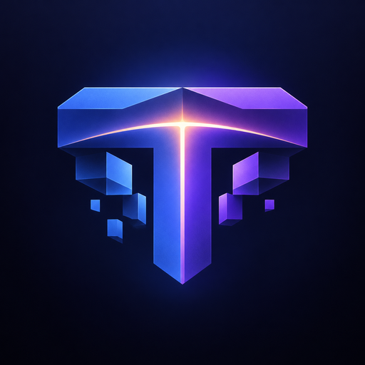

# Twilight wiki

> Türkçe: [aşağıda](#türkçe)

Twilight converts the custom content of a Java server (ItemsAdder, Nexo, CraftEngine, Oraxen,
BetterModel, ModelEngine, CustomNameplates, BetterHUD, datapacks and RealisticSeasons) into a Bedrock
resource pack and Geyser mappings, and makes Bedrock players see it the way Java players do. The
project ships two plugins:

| Plugin | Runs on | Purpose |
|---|---|---|
| `Twilight.jar` | Paper, Folia, Spigot 1.21.4+ (backend servers) | Builds the Bedrock pack, deploys it to Geyser, lays out text, biomes and names at runtime |
| `TwilightProxy.jar` (twilight-proxy) | Velocity, BungeeCord/Waterfall (proxies) | Gives every backend server its own Bedrock pack through Geyser on the proxy |

This page is the reference for administrators and plugin developers. Measurements and screenshots
are in the [reports](docs/); limits per feature are in [docs/COMPATIBILITY.md](docs/COMPATIBILITY.md).

## Contents

1. [Requirements](#requirements)
2. [Installation](#installation)
3. [How a build works](#how-a-build-works)
4. [Commands and permissions](#commands-and-permissions)
5. [Configuration reference: Twilight](#configuration-reference-twilight)
6. [twilight-proxy](#twilight-proxy-1)
7. [Bedrock network](#bedrock-network)
8. [Player heads](#player-heads)
9. [Custom blocks](#custom-blocks)
10. [Pack hosting](#pack-hosting)
11. [Updates](#updates)
12. [Files and folders](#files-and-folders)
13. [Developer API](#developer-api)
14. [Plugin-message protocol](#plugin-message-protocol)
15. [Security model](#security-model)
16. [Troubleshooting](#troubleshooting)
17. [Building from source](#building-from-source)

## Requirements

| Component | Version |
|---|---|
| Java | 21 or newer (Twilight is built with Java 25, release 21) |
| Backend server | Paper, Folia or Spigot 1.21.4 or newer; newest versions first (tested on Paper 26.2) |
| Geyser | 2.x with custom content enabled; the runtime bridges are validated against Geyser 2.11.3 and 2.12.0 |
| Bedrock clients | The current release (tested with 1.26.5203); older ones as far as Geyser supports them |
| Proxy (optional) | Velocity 3.x/4.x or BungeeCord/Waterfall with Geyser on the proxy (tested on Velocity 4.2.0 and BungeeCord 26.1) |

## Installation

### A single server

1. Put `Twilight.jar` in `plugins/` next to Geyser-Spigot and start the server.
2. Nothing has to be configured. After the server and the content plugins have loaded, Twilight
   finds their packs, builds the Bedrock pack and deploys it to Geyser.
3. Bedrock players receive the pack the next time they join; nobody is disconnected and Geyser is not
   reloaded. When custom items, blocks or player heads changed, the console asks for one restart,
   because Geyser registers them only at startup.

### A network with a proxy

1. Install `Twilight.jar` on every backend that has custom content; Geyser-Spigot on the backends
   is not needed.
2. Install Geyser and `TwilightProxy.jar` on the proxy.
3. Forward player data with Velocity's `modern` (or `bungeeguard`) forwarding or BungeeGuard. Both
   plugins then share that secret automatically. Without it, set the same `secret` in
   twilight-proxy's `config.yml` and `proxy.secret` in each backend's Twilight `config.yml`.
4. Each Bedrock player now loads the pack of the server they join; see [twilight-proxy](#twilight-proxy-1).
5. Custom items need no copying: twilight-proxy writes every server's Geyser item mappings into the
   proxy's Geyser ([item mappings on a proxy](#item-mappings-on-a-proxy)). Restart the proxy once after
   the first packs arrived, and after item changes when the log asks for it. Start the proxy's Java with
   `-Duser.language=en -Duser.country=US` when its system locale is Turkish or Azerbaijani.

Optional on both layouts: let Bedrock players download the packs over HTTP from the server that runs
Geyser instead of Geyser's slower in-game transfer, with the [pack host](#pack-hosting).

## How a build works

1. **Discovery.** Twilight reads the folders and generated packs of the installed providers. The
   pack a provider sends to Java players outranks its working folders, which fill gaps; a provider
   whose settings do not send its pack, or whose plugin is not installed, only fills gaps. World
   datapacks and `sources.additional` are added. Each provider can be limited with
   `sources.providers`. While ItemsAdder or CraftEngine has not generated its pack yet, the folders
   and ZIPs it is set to merge into it (`merge_other_plugins_resourcepacks_folders`,
   `merge-external-folders`, `merge-external-zip-files`) are read too; inside `plugins/` only.
2. **Runtime items.** Recipe results, online inventories and the providers' item registries are read
   through public APIs, so items that exist only at runtime are converted too. When ModelEngine's
   registry cannot be read, its bone items come from the pack it generates. ModelEngine and BetterModel
   bones only ever appear in item displays: they get a display model and no Bedrock item of their own,
   and without display models they are left out.
3. **Compilation.** Item models, textures, fonts, sounds, translations, biome looks and UI files are
   converted. Content that Java itself shows broken (a missing texture or model, a screen-sized
   overlay glyph) is converted the way Java shows it and reported as a notice. Content that cannot be
   represented safely is a problem; with `generation.strict: true` a build with problems is not
   published, except for the very first pack of a server.
4. **Export and deployment.** The pack and Geyser mappings are written to
   `plugins/Twilight/export/` and deployed transactionally to Geyser (with snapshots for rollback).
5. **Runtime.** While players play, Twilight lays out Java text for Bedrock (titles, chat, action bar,
   boss bars, scoreboards, names, text displays), applies Java's name rules, maps custom biomes and
   forwards biome updates.

Builds run again automatically after provider reloads, provider pack commands and RealisticSeasons
season changes. Unchanged inputs are detected by a fingerprint and skipped.

## Commands and permissions

### Twilight (backend)

| Command | Description |
|---|---|
| `/twilight status` | Operation state, last scan, input fingerprint, Geyser folder, snapshots and update check |
| `/twilight scan` | Discover and inspect sources without building |
| `/twilight convert` (alias `build`) | Scan, build, export and deploy |
| `/twilight deploy` | Deploy the last build to Geyser again |
| `/twilight rollback [n]` | Restore the n-th newest Geyser snapshot (default 1) |
| `/twilight reload` | Reload and validate `config.yml` |
| `/twilight network` | The [Bedrock network](#bedrock-network) layer per Bedrock player: round trip, inputs per second, strain, hidden and waiting entities, updates merged away, zlib level |
| `/twilight menus [reset]` | The menus players opened since start, whatever plugin made them, and how Bedrock gets their titles: plain or laid out, offset tags a plugin left unreplaced, characters the pack has no image for, player heads and custom items. Writes `reports/menus.json`; `reset` starts over |

Alias: `/tw`. Permission: `twilight.admin` (default: operators). Long operations run off the server
thread; only one runs at a time. Players with `twilight.update` (default: operators) are told about
new versions ([updates](#updates)).

### twilight-proxy

| Command | Description |
|---|---|
| `/twilightproxy` | Shared-secret state, Geyser presence, update check and the pack of every server |
| `/twilightproxy reload` | Reload `config.yml` and every pack |
| `/twilightproxy network` | The [Bedrock network](#bedrock-network) layer per Bedrock player on the proxy's Geyser |

Alias: `/twproxy`. Permission: `twilight.proxy.admin`. Players with `twilight.proxy.update` or
`twilight.proxy.admin` are told about new versions; proxies have no operators, so grant it with a
permission plugin (LuckPerms) or, on BungeeCord, in the `permissions` section of `config.yml`.

## Configuration reference: Twilight

`plugins/Twilight/config.yml`. Every key has a working default; the file only needs editing to
change behaviour.

### Updates and repairs of the file

Twilight keeps `config.yml` current at every start and `/twilight reload` (twilight-proxy does the same
with its `config.yml`), without touching what an administrator chose:

- **New settings** of a newer version are added with their default value and their explanation, at the
  place they have in the default file and indented like the file around them.
- **Invalid values** (a word where a number belongs, a number out of range, an unknown option) are set
  back to their default one by one, with a warning naming the old value. Values are only tried one by one
  when the file as a whole is refused, so a value that is fine together with the others is never changed.
- **A file that is not readable YAML** is replaced by the last version that worked (or the defaults when
  there is none), with the new settings added.

Before anything is written, a copy of the old file goes to `config-backups/` (the newest ten are kept);
the new file is written to a temporary file and moved into place. The result must be readable, pass every
check and stay the same in a second run, or nothing is written. A file Twilight wrote is never changed
again by it unless someone edits it or a newer version brings new settings, so repairs cannot loop.
Comments, order, quoting, line endings, unknown keys (reported as possible typos) and the lists that are
yours (`sources.providers`, the proxy's `packs.server` and `local-backends.server`) stay as they are.
Files that are symbolic links, not saved as UTF-8, larger than 1 MiB or written with YAML anchors or
flow mappings are only read and checked, never changed.

### Top level

| Key | Default | Meaning |
|---|---|---|
| `vanilla-override` | `false` | Allow the pack to replace vanilla Bedrock assets (sounds, glyphs) that Java packs change |

### `generation`

| Key | Default | Meaning |
|---|---|---|
| `strict` | `true` | A build with problems is not published (the first pack of a server still is) |
| `auto-build-on-startup` | `true` | Build after the server and providers have loaded |
| `sync-provider-changes` | `true` | Build again after provider reload/pack events and commands |
| `startup-delay-ticks` | `40` | Delay before automatic builds (1-72000) |
| `provider-command-delay-ticks` | `100` | Delay after a provider command, for its output to be written |
| `maximum-source-bytes` | `1073741824` | Upper limit of all source bytes read in one build |
| `maximum-archive-entries` | `100000` | Upper limit of entries per source archive |
| `download-vanilla-assets` | `true` | Download the version's client assets from Mojang (hash-verified) when a build needs them |

### `sources`

| Key | Default | Meaning |
|---|---|---|
| `auto-discover` | `true` | Find providers and world datapacks on their own |
| `providers.<name>` | `auto` | Per provider (`itemsadder`, `nexo`, `craftengine`, `oraxen`, `bettermodel`, `modelengine`, `customnameplates`, `betterhud`, `realisticseasons`): `auto` / `true`, `generated` (only the generated pack), `contents` (only working folders), `off` / `false` |
| `datapacks` | `true` | Read the worlds' datapacks |
| `additional` | `[]` | More packs or datapacks (folders or ZIPs), relative to the server folder |

### `geyser`

| Key | Default | Meaning |
|---|---|---|
| `directory` | `auto` | Geyser's data folder; `auto` finds `plugins/Geyser-*` |
| `deploy-after-build` | `true` | Deploy each successful build |
| `reload-after-deploy` | `true` | Only where Twilight cannot offer each joining Bedrock player the current pack (a Geyser without the session pack event): run `geyser reload` after deploying when no restart is required. Otherwise Geyser is never reloaded, as that disconnects every Bedrock player |
| `backups-to-keep` | `3` | Geyser snapshots kept for `/twilight rollback` (1-20) |
| `send-pack-to-bedrock` | `true` | Let Geyser send the pack; `false` when a proxy or another plugin sends `export/Twilight.mcpack` |
| `retire-stale-files` | `true` | Move Twilight files this server does not own (older versions, copies, sync tools) out of the local Geyser to `plugins/Twilight/retired/`, at start before Geyser loads them and after every deployment |
| `restart-for-item-changes` | `notify` | Geyser registers custom items only at start. `notify`: tell the console and players with `twilight.admin`; `when-empty`: also restart once nobody is online (`spigot.yml` `settings.restart-script`; without one the server stops) |
| `loading-protection-seconds` | `300` | Keep a Bedrock player connected while its client is still loading the resource packs after joining: with Geyser's `forward-player-ping: true`, Java keep-alives and pings are answered for it until the client is in game, at most this long (0-1800; 0 only logs loading times). Without ping forwarding Geyser answers them itself and only the loading times are logged. Loads of 10 s or more are logged. Needs Geyser on this server; on a proxy network twilight-proxy does the same |
| `item-display-models` | `auto` | Bedrock models for custom items in Java item displays: furniture, ModelEngine and BetterModel models, and the mobs and NPCs built from them ([item displays](#item-displays)). `auto`: when Geyser runs on this server, or when the twilight-proxy in front of it says that it shows item displays; `on`; `off`. The pack is rebuilt by itself when that changes |
| `item-display-variants` | `seen` | Which items get those models. `seen`: the items this server has shown in item displays, and every model bone; `all`: every custom item (each client then builds a model for every item while loading) |
| `player-heads` | `true` | Player heads show their skins on Bedrock instead of Steve's (menus, hands, armour stands, holograms); new heads need a restart ([player heads](#player-heads)) |
| `player-head-skins-of-players` | `1024` | Also register the skins of this many most recent players, for heads of players that menus show (`0`: none) |
| `custom-blocks` | `true` | Content plugins' custom blocks (ItemsAdder's and CraftEngine's ores and blocks on note blocks, mushroom blocks and tripwire) get their own Bedrock look instead of the vanilla block, and the items that place them show the block in 3D in the inventory and when dropped. Geyser registers blocks when it starts: a build that changes them needs a restart, like item changes ([custom blocks](#custom-blocks)) |

### `ui`

| Key | Default | Meaning |
|---|---|---|
| `java-container-layout` | `true` | Java's chest layout and title position in Bedrock chest screens |
| `java-text-layout` | `true` | Lay out text with Java font metrics (spaces, negative spaces, images) |
| `java-text-surfaces` | `true` | Apply the layout to chat, action bar, titles, boss bars, scoreboards, names and text displays |
| `java-glyph-tint` | `true` | Darkened image copies for container titles without a colour, as Java draws them |
| `java-text-layers` | `true` | Text and images drawn back over earlier ones get one label per layer (chest titles, action bar, boss bars) |
| `nametag-background` | `auto` | Bedrock's name tag box: `auto` (hidden when CustomNameplates' name tags are on), `hidden`, `bedrock` |
| `java-translations` | `true` | Use the resource packs' translations for Bedrock players |
| `pocket-container-layout` | `java` | Chest screens on Bedrock's pocket UI profile (the default on phones and tablets). `java`: the same Java layout as on desktop, so menu art fits its slots; `bedrock`: Bedrock's two-column pocket screens, where the title sits in a header bar and menu art ends up behind the slots. Needs `java-container-layout` and a rebuild |
| `max-glyph-cell` | `512` | Largest glyph cell in pixels (512, 256, 128, 64). A page is 16 cells wide and as large as its largest cell: a glyph that needs 512 makes its page 8192x8192 (256 MiB in the client), which the build names. With the text layout, glyphs of 256 and more go to pages of their own, so small glyphs stay on small pages. With 256, glyphs Java draws far above or below the line are moved vertically to fit, and menu art then no longer lines up with the slots. Needs a rebuild |

### `world`

| Key | Default | Meaning |
|---|---|---|
| `bedrock-biome-matching` | `true` | Exact colours and climate for custom biomes in 25 redefined Bedrock biomes, the closest vanilla biome otherwise, and live biome updates |

### `proxy`

| Key | Default | Meaning |
|---|---|---|
| `share-pack` | `true` | Offer the exported pack to twilight-proxy over signed plugin messages |
| `secret` | `""` | Secret shared with twilight-proxy (16+ characters); empty uses Paper's Velocity secret or BungeeGuard tokens |

### `pack-host`

The [pack host](#pack-hosting): Bedrock players download Geyser's packs from this server over HTTP. It
runs only when Geyser is installed on this server. The keys are listed in the [pack host](#pack-hosting)
section; the proxy uses the same section.

### `bedrock-network`

The [Bedrock network](#bedrock-network) layer on this server's Geyser. Numbers accept `auto`, which follows
each player's connection.

| Key | Default | Meaning |
|---|---|---|
| `enabled` | `true` | Run the layer (restart to apply) |
| `threads` | `auto` | Line-of-sight worker threads; `auto` = half of `netty-threads` in spigot.yml, 1-4 (restart to apply) |
| `culling` | `true` | Hold back entities outside the view |
| `cull-players` | `true` | Other players too, with 1.5 times the distances |
| `view-angle` | `auto` | Degrees of view counted as visible (90-360); `auto` = 220, wider with ping; 360 turns view culling off |
| `behind-distance` | `auto` | Entities closer than this always get every update; `auto` = 10-24 blocks by ping |
| `wall-culling` | `true` | Hold back entities behind walls |
| `wall-distance` | `auto` | Walls hide only from this distance on; `auto` = 16-32 blocks by ping |
| `wall-thickness` | `auto` | Solid, opaque blocks every line of sight must cross; `auto` = 3 |
| `far-distance` | `auto` | Visible entities beyond it get fewer movement updates; `auto` = 40 blocks |
| `hidden-update-ms` | `auto` | How often hidden entities are brought up to date anyway; `auto` = 1000-3000 ms by connection |
| `packets-per-second` | `auto` | Entity updates per player and second that may wait; `auto` = 2400 down to 600 |
| `adaptive-compression` | `true` | Up to two zlib levels more for struggling connections |

### `update-check`

| Key | Default | Meaning |
|---|---|---|
| `enabled` | `true` | Look for a newer release shortly after start and every six hours ([updates](#updates)) |
| `notify-players` | `true` | Tell players with `twilight.update` when they join and when a version is found |

Changes to `ui` and `world` keys need a new build (`/twilight convert`); `proxy` and `pack-host` keys
and `geyser.send-pack-to-bedrock` take effect on restart; `update-check` and `bedrock-network` (except
`enabled` and `threads`) on `/twilight reload`.

## twilight-proxy

Bedrock loads resource packs once, when it connects. twilight-proxy therefore registers, for each
Bedrock session, the pack of the server the player is about to join (through Geyser's
`SessionLoadResourcePacksEvent`). When the player later moves to a server with another pack, the
client is transferred back to Geyser, loads that pack and is sent to the server it asked for. The
reconnect takes about five seconds when the client has the pack cached; otherwise Bedrock asks once
to download it. Servers with the same pack never cause a reconnect.

### Configuration

`plugins/twilight-proxy/config.yml`:

```yaml
packs:
  default: auto          # servers that are not listed
  server:
    lobby: auto                                  # pack built by Twilight on that backend
    smp: https://example.com/packs/smp.mcpack    # direct download link (cached, refreshed)
    survival: survival.zip                       # file in plugins/twilight-proxy/packs/
    hub: none                                    # no per-server pack
transfer-on-switch: true
transfer-address: ""     # empty = the address the player joined with
transfer-port: 0         # 0 = the port the player joined with
initial-server: ""       # empty = the proxy's first server
transfer-timeout-seconds: auto  # or 60-7200
login-servers: []        # e.g. [auth, limbo]
secret: ""               # empty = Velocity forwarding secret or BungeeGuard token
max-pack-size-mb: 256
download-timeout-seconds: 60
url-refresh-minutes: 60  # 0 = only at start and reload
pack-host:               # see "Pack hosting"
  enabled: false
  port: 8163
update-check:            # see "Updates"
  enabled: true
  notify-players: true
bedrock:                 # see "Bedrock runtime on the proxy"
  text-layout: true
  translations: true
  loading-protection-seconds: 300
  custom-blocks: true
```

| Key | Meaning |
|---|---|
| `packs.default` | Source for servers without an entry |
| `packs.server.<name>` | `auto`, `none`, a file name in `packs/`, or an `http(s)` link to a `.zip`/`.mcpack` |
| `transfer-on-switch` | Reconnect Bedrock players whose next server needs another pack |
| `transfer-address`, `transfer-port` | Where transferred players reconnect (useful behind a load balancer) |
| `initial-server` | Server whose pack a new session loads |
| `transfer-timeout-seconds` | How long a reconnect may take, from the transfer until the player reaches its server (download and login included). `auto`: three minutes plus the pack at 128 KiB/s, at most an hour (a 150 MiB pack: 23 minutes) |
| `login-servers` | Servers players pass through before playing (login, captcha, limbo): Bedrock players are never reconnected for them, and a reconnect in progress continues when the player moves on. The login servers in the configuration of LeaderOS Auth, AuthMeVelocity, AuthMeBungee, LibreLogin, JPremium and similar plugins are added automatically (only for plugins the proxy loaded; logged at start, shown by `/twilightproxy`), and login plugins that choose such a server are detected at run time as well |
| `secret` | Shared secret for `auto` packs |
| `max-pack-size-mb` | Largest accepted pack (1-2048) |
| `download-timeout-seconds` | A link download stops after this long without data, or when it is slower than 64 KiB/s overall (5-600) |
| `url-refresh-minutes` | How often links are checked for a new version with their ETag (0-10080) |
| `pack-host.*` | Serve the packs from the proxy over HTTP; see [pack host](#pack-hosting) |
| `update-check.enabled` | Look for a newer release shortly after start and every six hours ([updates](#updates)) |
| `update-check.notify-players` | Tell players with `twilight.proxy.update` or `twilight.proxy.admin` when they join and when a version is found |
| `bedrock.text-layout` | Lay out Java text with each server's fonts in the proxy's Geyser ([Bedrock runtime](#bedrock-runtime-on-the-proxy)) |
| `bedrock.translations` | Show the server packs' translations to Bedrock players |
| `bedrock.loading-protection-seconds` | Keep a Bedrock player connected while its client loads the resource packs, at most this long (0-1800, default 300) |
| `bedrock.custom-blocks` | Register the servers' custom blocks with the proxy's Geyser and show their items in 3D ([custom blocks](#custom-blocks)) |
| `bedrock.player-heads` | Register the player heads the servers' packs list with the proxy's Geyser, so they show their skins ([player heads](#player-heads)) |
| `bedrock.item-displays` | Show Java item displays with the servers' models: furniture, ModelEngine and BetterModel models, the mobs and NPCs built from them ([item displays](#item-displays)); also applies Java's rule that a ridden mob shows no name |
| `bedrock-network.*` | The [Bedrock network](#bedrock-network) layer on the proxy's Geyser, with the same keys as on a backend; `threads: auto` = a quarter of the processors (1-4) |

Every pack is checked before use: it must be a ZIP below the size limit with `manifest.json` at its
root and no entry that could escape a folder. A pack that fails the check, a failed download or an
incomplete transfer keeps the previous pack.

### Attaching to Geyser

twilight-proxy attaches to the proxy's Geyser when the proxy starts. On Velocity both start in the
same event and twilight-proxy runs last; a Geyser that is still loading is tried again every two
seconds for two minutes and then whenever a player joins. The log says which case applies:

| Log line | Meaning |
|---|---|
| "Attached to Geyser: Bedrock players get each server's pack." | Working |
| "Geyser is installed but not started yet; attaching when it is ready." | Followed by "Attached to Geyser after it started" |
| "Geyser is not installed on this proxy" | No Geyser plugin on this proxy |
| "Geyser-BungeeCord ... is installed, but its API is not visible to twilight-proxy" | The proxy (a fork that isolates plugins) hides Geyser's classes; retried like a Geyser that is still loading, and the reason is logged |
| "Could not attach to Geyser: ..." | Geyser's API refused the listeners; the reason, the full stack trace and the jars Geyser's event library came from follow. Update Geyser and twilight-proxy. |

`/twilightproxy` shows the state ("Geyser attached" or "Geyser not attached (reason)"), whether the
pack host runs, the item mappings and the login servers.

### Item mappings on a proxy

Geyser on the proxy translates the items of every backend, so it needs every backend's custom item
mappings. Twilight puts them into the pack it shares (`twilight/geyser_item_mappings.json`, ignored
by Bedrock); twilight-proxy takes them from `auto` packs and pack files in `packs/` (never from
download links), keeps only well-formed Twilight entries, merges them and writes
`custom_mappings/twilight-proxy_item_mappings.json` in Geyser's folder. Geyser reads that folder once,
when it starts:

- At proxy start the file is written before Geyser reads it: from the current builds of backends on
  the same machine ([local backends](#local-backends)), otherwise from the packs of the last run. On
  BungeeCord forks that start Geyser before enabling other plugins (FlameCord) this happens in the
  plugin load phase, with the server list read from the proxy's `config.yml`.
- When a server's items change later, the console and players with `twilight.proxy.admin` (when they
  join) are told to restart the proxy; until then those items show as their base item for Bedrock
  players. With `item-mappings.restart: when-empty` the proxy stops by itself a minute later once
  nobody is online, for hosts that start it again (panel auto-restart, a start script loop, systemd
  `Restart=always`). Geyser cannot register items without a restart; `geyser reload` does not.
- The same Java item (custom model data or item model) is the same Bedrock item on every backend,
  and each server's pack decides how it looks there. When two servers map the same selector to
  different Bedrock items (older Twilight versions, hand-made packs), the first server in name order
  wins and the log lists each conflict.
- Other Twilight files in the proxy's Geyser (`twilight*.json` under `custom_mappings`, and packs
  named `twilight*` or whose manifest is named "Twilight") are moved to
  `plugins/twilight-proxy/retired/<time>/` before Geyser loads them (`item-mappings.retire-stale-files`).
  They come from older versions, copies by hand or sync tools, and would register the same items with
  other Bedrock identifiers or send a second Twilight pack: broken icons. Stop such a tool as well.
- Geyser reads mapping types with the Java locale. On a proxy whose locale is Turkish or Azerbaijani
  it skips every item model mapping; the log warns and the fix is `-Duser.language=en
  -Duser.country=US` on the proxy's Java command.

### Local backends

Backends on the same machine as the proxy are read from their folders: twilight-proxy finds each proxy
server with a local address (`127.0.0.1`, `localhost` or an address of this machine) in the folder next
to the proxy's whose `server.properties` uses that port and which has Twilight installed, and reads
`plugins/Twilight/export/Twilight.mcpack` there. No player has to join a server first, the proxy's
Geyser starts with every server's current items, and a new build is picked up within seconds.
`/twilightproxy` lists them.

```yaml
local-backends:
  mode: auto          # off: plugin messages only
  search: []          # more folders that hold server folders, e.g. [/srv/minecraft]
  server:             # a folder per server when discovery cannot tell
    survival: ../survival
```

When two folders use the same port (backup copies), the most recently active one is used and the log
names both; set it under `server` to be sure. Only that one file in such a folder is read, symbolic
links are refused, and the pack is checked like every other. Backends on other machines keep using
plugin messages.

### Bedrock runtime on the proxy

On a single server, Twilight changes text in that server's Geyser before Bedrock gets it. On a network,
Geyser runs on the proxy, so twilight-proxy does the same there, with the pack each player loaded:

- **Text layout** (`bedrock.text-layout`): custom font images (chat prefixes, menu titles, HUD images),
  named fonts, spaces and negative spaces. It also covers images on characters outside the private-use
  area, such as ItemsAdder images on U+A840. Bedrock draws those characters with its own font, so the
  pack draws the image on another character and every message is changed to use it. Without this
  runtime, such a prefix shows as a plain Unicode character. Offset tags a plugin left unreplaced
  ([offset tags](#offset-tags)) move the text as on the backend.
- **Translations** (`bedrock.translations`): item and menu names from datapacks and plugins.
- **Loading protection** (`bedrock.loading-protection-seconds`): until the client reports that it is in
  game, the proxy answers Java keep-alives and pings for it when Geyser's `forward-player-ping` is `true`.
  Large packs take minutes on phones, and the proxy would otherwise drop the player ("read timed out").
  Without ping forwarding Geyser answers them itself. Loads of 10 s or more are logged:
  - "&lt;player&gt; finished loading its resource packs after N s; the connection was kept alive for it
    meanwhile."
  - "&lt;player&gt; left while its client was still loading the resource packs, after N s: &lt;reason&gt;"
- **Item displays** (`bedrock.item-displays`): furniture and the mobs and NPCs of ModelEngine, BetterModel
  and MythicMobs, including the ones plugins send only as packets ([item displays](#item-displays)).
- **Ridden mobs** keep no name, as on Java, so nameplate plugins do not show a second name.

Each player's layout and display models follow the pack it loaded and change when a reconnect loads
another pack.

### Offset tags

Menus place their background images with offsets: characters that move the text by some pixels (negative
and positive spaces of ItemsAdder, Nexo, Oraxen, CraftEngine and hand-made packs, `space` providers). The
layout measures those like Java. Some menus carry the offset as a tag that a content plugin replaces before
the text is sent:

| Tag | Plugin |
|---|---|
| `:offset_-8:`, `%img_offset_-8%` | ItemsAdder |
| `%nexo_shift_-8%`, `%oraxen_shift_-8%` | Nexo, Oraxen |
| `<shift:-8>` | CraftEngine, Nexo, Oraxen |

When a tag still reaches Bedrock players (a menu plugin that formats titles itself, an outdated content
plugin, a provider that handles Bedrock players differently), the layout moves by the tag's value instead
of drawing its letters, so the background after it sits where Java's offset would put it. Tags are read in
any case and up to 4096 units; anything else stays text. Java players see an unreplaced tag as text: then
the plugin that should replace it is missing or outdated.

### Item displays

Java shows furniture and the models of ModelEngine and BetterModel (and the MythicMobs mobs and NPCs that
use them) with item displays: entities that draw an item with a transformation. Bedrock has no such
entity. Twilight registers one with Geyser, on the server (Geyser-Spigot) or on the proxy
(twilight-proxy), and follows every display's item, transformation and interpolation from the Java
packets, so the models move exactly as on Java. Displays that plugins send only as packets are shown as
well.

- **Models in sheets.** A Bedrock client builds the model of every display variant while it loads the
  pack. One geometry per item made a pack with 3,413 variants load for 156 s. The variants are now
  merged into sheets of 64 items, with one texture per sheet, and the display's transform for each Java
  context comes from the server: the Survival pack with 5,533 variants (2,099 ModelEngine bones) loads in
  25 s instead of minutes, and in 11 s with `item-display-variants: seen`.
- **Only what is shown.** With `item-display-variants: seen` (the default), items get a display model
  once they appear in an item display: Twilight learns them as chunks load and as displays spawn, and
  twilight-proxy reports the ones its players saw that the pack could not show yet (displays sent only
  as packets never exist on the server). The next build, at most a minute later, adds them, and Bedrock
  players who join after it see them without a restart; the list is kept in `displayed-items.txt`.
  ModelEngine and BetterModel bones always get one.
- **Bones without items.** Model bones only appear in displays, so they get no Bedrock item, attachable
  or icon: the pack is smaller and Geyser registers fewer items.
- **On a proxy network.** Twilight on each backend learns from twilight-proxy that it shows item
  displays (a signed message whenever the server announces its pack or a player arrives) and builds the
  models then; it remembers that in `proxy-features.properties`. An older twilight-proxy does not say
  so, and the backend then leaves the models out as before.

What displays and holograms show (FancyHolograms, DecentHolograms, furniture plugins, display builds; also
when plugins send them only as packets):

| Java | On Bedrock |
|---|---|
| Item display of a custom item | Its model, 3D or as Java's one-pixel extrusion of a flat sprite |
| Item display of an item without custom data | The item's own model (from the server's packs or the vanilla client), tinted like Java (dyes, potions, grass) |
| Block display | The block state's model, rotated as its block state file says (stairs, logs, fences, furnaces) and tinted like Java without a world (grass, leaves, redstone) |
| Billboard (`fixed`, `vertical`, `horizontal`, `center`) | Faces the camera like Java |
| Brightness override | The display ignores the world's light and is drawn at Java's light level |
| Translation, rotations, scale, interpolation | As Java (see above) |
| Dropped item (item entity) of a custom item with a 3D model | Its model in Java's ground pose, bobbing and spinning like Java; flat and vanilla items stay Bedrock's own dropped items |
| Text display | Geyser's name tag (Bedrock has no scalable text entity) |
| Glow outline, shadow, glow colour | Not drawn (no Bedrock counterpart for a model) |

Items and block states get their models the same way custom items do: once a display shows them
(`item=` and `block=` keys in `displayed-items.txt`), the next build adds them, whatever
`item-display-variants` says. A dropped stack is drawn once, not as Java's pile of copies.

### Sources

- **auto**: Twilight on the backend announces its exported pack when a player joins and after each
  build. The proxy requests it if its copy differs and stores it in `cache/<server>.mcpack`. A 2.2 MiB
  pack arrives in about four seconds.
- **file**: read from `plugins/twilight-proxy/packs/` at start and reload.
- **link**: downloaded in the background over HTTP(S) to `cache/link-<hash>.mcpack`; redirects to
  plain HTTP are not followed.

Geyser reads a pack file again for every piece it sends, so each pack version is copied to
`cache/versions/<sha256>.mcpack` and Geyser reads only that copy: a pack rebuilt or replaced during a
long download never changes under it. A new pack is also hashed for Geyser (and copied for the pack
host) as soon as it arrives, so the first player who needs it does not wait for that during login.

### Reconnects, login plugins and protections

A reconnect goes through these steps, each written to the proxy log:

1. `Reconnecting <player> to load the Bedrock pack of <server> (<size>); waiting up to <n> min` - the
   client is transferred to `transfer-address`/`transfer-port` or the address it joined with. Packs of
   32 MiB or more also print how long Geyser needs for them and suggest the pack host.
2. `<player> reconnected after <n> s` - Geyser saw the client again and offers it the server's pack.
3. `<player> is back ... sending it to <server>` / `reached <server> <n> s after the transfer
   (reconnect, pack and login)` - the player is on the server it asked for.

Login plugins (AuthMe with AuthMeVelocity or AuthMeBungee, LibreLogin, nLogin, JPremium and similar)
keep the last word, because a reconnect is a new connection that may have to log in again:

| What the login plugin does | What twilight-proxy does |
|---|---|
| Sends the reconnected player to its login server first | Lets it; after the login, when the login plugin sends the player on (for example to the lobby), the player is sent to the server it reconnected for instead, through a new connection request that every plugin checks again |
| Refuses every other server before the login | Notices the refusal of the first server, lets the player join the proxy's first server and continues the same way after the login |
| Keeps a session (no new login after a reconnect) | Nothing to do: the player goes straight to its server |
| Changes the target after every other plugin (BungeeCord priority 127) | A reconnect only counts as arrived once the player is connected to its server, so a later change is noticed and handled like a login server |
| Sends the player back to the server it asked for after the login | Nothing to do: the player arrives there |

Tested with LeaderOS Auth Plus 1.1.1 on BungeeCord (with BungeeGuard, with and without Floodgate) and
on Velocity (LimboAPI login), and with a stand-in for the other behaviours above; see the
[login plugin test](docs/PROXY_AUTH_2026-10-09.md).

A reconnect never causes a second one by itself: when a plugin sends the reconnected player somewhere
else first, the player waits there with the pack it loaded. A fresh session whose first server is not
the one its pack was chosen for (BungeeCord sends players back to their last server, forced hosts,
hub balancers) is reconnected once, a few seconds after it is in game, for that server's pack; set
`initial-server` to the server players join first to avoid it. Each player is reconnected at most
four times in five minutes; after that it joins with the pack it has (logged as a warning). A
reconnect that is not finished by its deadline is abandoned (logged).

Forwarding stays as it is: Velocity modern forwarding, BungeeGuard and legacy forwarding see a
reconnected player like any other login. Protections in front of the network have to allow one
quick reconnect per server change:

- The client comes back about four seconds after the transfer. Velocity's `login-ratelimit` must not
  be longer than that (the default 3000 ms is fine; twilight-proxy warns when it is longer).
- UDP DDoS protection and anti-bot plugins (for example SafeNET, Sonar or EpicGuard) must not block or
  challenge a Bedrock client that reconnects right after leaving. If a player has not come back 60
  seconds after the transfer, the log says so and names the address it was sent to; Bedrock shows
  "Server not found" when it cannot reach that address.
- Large packs: Geyser sends at most about 1.2 MiB/s (a 150 MiB pack took 172 seconds in tests).
  The [pack host](#pack-hosting) lets Bedrock download them over HTTP instead.

### Recommended network settings

A pack reconnect is a new login on the proxy. Everything that treats new logins specially (login
plugins, anti-bot checks, connection limits) sees it, so these settings keep it short and safe.

**Geyser (on the proxy, `plugins/Geyser-*/config.yml`)**

| Setting | Value | Why |
|---|---|---|
| `auth-type` | `floodgate` with Floodgate installed, otherwise `online` | Bedrock players are verified by Xbox Live; with Floodgate they need no Java account |
| `validate-bedrock-login` | `true` | Never turn it off: it is what makes the Xbox identity (XUID) trustworthy |
| `use-haproxy-protocol` + `haproxy-protocol-whitelisted-ips` | only behind a UDP front that sends PROXY protocol | Otherwise every player appears to come from the front's address (sessions, IP limits and pack-host links break) |

**Floodgate (proxy and backends)**

| Setting | Value | Why |
|---|---|---|
| Installed on | the proxy, and on every backend when the proxy forwards Floodgate data | Backends then know a player is Bedrock (forms, skins, plugins that ask Floodgate) |
| `key.pem` | the same file on the proxy and every backend, never published | It signs the Floodgate data the proxy forwards |
| `send-floodgate-data` (proxy) | `true` when backends run Floodgate | |
| `username-prefix` | keep the default `.` | Bedrock names cannot collide with Java names |

**Proxy**

| Setting | Value |
|---|---|
| Velocity `player-info-forwarding-mode` | `modern` (or `bungeeguard`); BungeeCord: `ip_forward: true` with BungeeGuard |
| Velocity `login-ratelimit` | 3000 (default) or less; a reconnect logs in about four seconds after leaving |
| Velocity `accepts-transfers`, BungeeCord `reject_transfers` | leave as they are; Bedrock reconnects do not use Java transfers |
| Backends | reachable only from the proxy (firewall or bind address); `bukkit.yml` `connection-throttle: -1` |
| Proxy Java command | `-Duser.language=en -Duser.country=US` when the system locale is Turkish or Azerbaijani (Geyser item mappings) |

**twilight-proxy**

| Setting | Value |
|---|---|
| `transfer-address`, `transfer-port` | the public Bedrock address when players join through another one (DNS split, load balancer) |
| `login-servers` | the login server(s), e.g. `[auth_lobby]`; found automatically in the login plugins named above |
| `transfer-timeout-seconds` | `auto` |
| `pack-host` | enabled for packs above a few MiB |

**Login plugins**

- Enable IP sessions, long enough for a reconnect plus a large pack download (a few minutes). A
  reconnected player then logs in automatically instead of typing the password again.
- Prefer a plugin that returns the player to the server it asked for after the login, instead of a
  fixed "send after login" server; twilight-proxy also sends it on when the plugin moves it once.
- Logging Bedrock players in automatically because they are Floodgate players is safe only when the
  account is bound to that player's XUID (checked through the Floodgate API, never by name).
- If the plugin refuses a login while the same name is still online, a reconnect can be refused for a
  moment; the player then lands on the proxy's fallback server.

## Bedrock network

Bedrock clients pay for every entity update they receive, also for entities they cannot see: a crowded
farm behind the player, mobs behind a mountain, a hologram that animates in the next room. Twilight's
network layer sits in every Bedrock connection of the Geyser it runs on (a backend's own Geyser or the
proxy's) and holds back what the player cannot see (`bedrock-network`):

- **Behind the player.** Movement and data (names, poses, animations) of entities outside the view are
  held. Entities closer than `behind-distance` always get every update, wherever they are.
- **Behind walls.** An entity counts as hidden only when every line of sight to it (feet, middle, top
  and both sides) crosses at least `wall-thickness` solid, opaque blocks (3 by default). One wall, glass,
  leaves, fences, doorways and unloaded chunks never hide anything, and neither do entities with a name
  tag (Bedrock draws name tags through walls) or display entities (their model may sit away from them).
  Lines of sight are tested from a snapshot on a few shared worker threads (`threads`), at most 256
  entities per player and round, with a lookup budget; a result needs two rounds in a row to hide.
- **Far away.** Visible entities beyond `far-distance` get fewer movement updates the farther they are
  (up to 4 to 10 a second).
- **Budget.** Entity movement and data that may wait are limited per player and second
  (`packets-per-second`); the nearest go first and nothing waits longer than three refresh intervals.
- **Compression.** A struggling connection gets zlib compression up to two levels above Geyser's
  (`adaptive-compression`); a healthy one keeps Geyser's level.

Held updates are merged: the latest position, rotation and data win and a teleport stays a teleport. They
are sent as one update when the entity comes into view (a turn of 15 degrees or a few blocks of movement
checks at once, a clear line of sight within a round), every `hidden-update-ms` meanwhile, or when the
budget allows. The view counted is wider than the screen (220 degrees by default), so entities are brought
up to date shortly before they can appear. Spawns, removals, chunks, inventories, chat, sounds, effects
and entity motion always pass unchanged and in order, and a revealed entity always shows the server's
latest state. While a plugin moves the camera elsewhere (camera instructions), nothing is culled.

**Following the connection.** Every value set to `auto` follows each player: the round trip widens the
margins (a player with 300 ms ping is revealed earlier and with a wider view), and a client that does not
keep up (fewer than 20 inputs a second, or a full send buffer) gets fewer updates, a slower refresh of
hidden entities and stronger compression. Limits tighten at once and relax over a few seconds.
`/twilight network` (on a proxy `/twilightproxy network`) shows per player the round trip, the input rate,
the strain, how many entities are hidden or waiting, the share of updates merged away and the zlib level.

**Measured.** A test pipeline with Geyser's packets and 1200 mobs moving every tick around a turning
player behind walls spares 59 percent of the entity updates at about 1.5 microseconds per packet, and
afterwards the client agrees with the server about every entity. On a test server with 300 cows around a
Bedrock player and a wall, 37 percent of the updates were merged away; the server's tick time stayed at
1.7 ms. Random traffic (unknown ids, NaN and huge coordinates, removals, garbage input) is part of the tests.

If anything in the layer fails, it sends everything it held and passes all packets unchanged for the rest
of that session; a failure to read the world only turns off wall culling for that player.

## Player heads

Without help a Bedrock player head is Steve's: Geyser draws a head's skin only for skulls it registered as custom
blocks when it started. Twilight finds the heads a server shows and puts their skins into the pack, and Geyser on
the server and on the proxy registers them (`geyser.player-heads`, `bedrock.player-heads`):

- **Menus.** Every menu a player opens is read a moment after it opens and again two seconds later (menu plugins
  fill and refresh their items then), whatever plugin made it.
- **Configurations.** At start the plugins' configuration files are read for heads in every common form: Base64
  profiles (`basehead-...`, `texture: ...`), skin URLs and hashes (`texture-...`, `skin: ...`), user names
  (`head-Notch`, TrMenu's `head:Notch`, `skull-owner: Notch`) and HeadDatabase ids (`hdb-1234`, resolved through
  HeadDatabase when it is installed). Libraries, logs, generated resource packs and per-player data files are not
  read, and no plugin's folder takes more than 2500 files, so the scan stays short (a few seconds on a large
  server, off the main thread). Placeholders such as `head-%player_name%` are left to the menu scan, which sees
  the real head.
- **The players.** The skins of the players who join (`geyser.player-head-skins-of-players`, the 1024 most recent
  by default): menus often show a player's own head or other players' heads (profiles, top lists, friends,
  auction sellers), which no configuration names. Bedrock players' skins are read too, once Floodgate has them.
  A new player never starts a build or asks for a restart: the skins go into the next build and Geyser registers
  them at its next start; on a proxy, the players' skins of every server are taken in turn.
- **The world.** Armour stands, mobs, item frames, displays and dropped items, as their chunks load; heads in
  displays a plugin sends only as packets are reported by Geyser on the server or by twilight-proxy.

The heads are kept in `player-heads.txt` and the players' skins in `player-skins.txt` (a skin hash and the time
it was last seen; nothing else about the player). Geyser registers at most 4096 skulls; the heads the server shows
come first and the players' skins fill the rest. Geyser registers skulls when it starts, so a build with new
shown heads asks for a restart, like new items. A head in an item display is drawn with its skin as Java draws it
(the skin is downloaded once from Mojang's texture server into `cache/skins/`). Placed head blocks were already
drawn with their skins by Geyser.

## Custom blocks

Content plugins draw custom blocks through vanilla block states: ItemsAdder's `REAL_NOTE` blocks and
CraftEngine's blocks are note block, mushroom block or tripwire states whose model the pack replaces in
`assets/minecraft/blockstates`. Without conversion Bedrock shows the vanilla note block.

- Every such state with a custom model becomes a Bedrock block. Full cubes use Bedrock's block cube with a
  texture per face (and Java's x/y rotation); other shapes (plants on tripwire, decorations) get a block
  geometry. The blocks of every pack that defines states (ItemsAdder and CraftEngine side by side) are merged;
  where two packs define the same state, the effective pack's look is used, as on Java.
- The item that places a block (an item drawn with the same shape and art) shows the block in 3D in the
  inventory and when dropped, as on Java.
- Breaking, drops and placement stay Java's: the server decides them.
- Block names follow the Java state, so a proxy network's single Geyser registry gives a state the same Bedrock
  block on every backend and each server's pack draws it its own way. Where two servers give a state a
  different shape, the first server's shape is used and the proxy log says so.
- Geyser registers blocks when it starts. twilight-proxy subscribes in the proxy's plugin load phase, so this
  also works on BungeeCord forks that start Geyser before enabling other plugins (FlameCord). After a build that changes blocks, the log and admins are told to
  restart (`restart-for-item-changes` and twilight-proxy's `item-mappings.restart` apply).
- Not converted: multipart blockstates, chorus plants and blocks other than note blocks, mushroom blocks and
  tripwire; block light from content plugins (they place light blocks themselves); animated block textures
  show their first frame. Shapes that reach past Bedrock's block bounds (2 pixels less than Java on each side)
  are pulled in.

The build report counts them (`custom_blocks`, `block_items`); the server or proxy log says
"Registered N custom block(s) for Bedrock players" and "N custom item(s) show their block in 3D".

## Pack hosting

Geyser normally sends a pack inside the game connection, in small chunks, which takes a while for
large packs. Like ItemsAdder's or CraftEngine's self-host, the pack host serves the packs over HTTP
from a TCP port of the server that runs Geyser: Bedrock downloads them directly, much faster. Unlike
those, it is not a public download: a pack can only be fetched with a link minted for one Bedrock
player who is connecting through Geyser at that moment.

Enable it where Geyser runs: in Twilight's `config.yml` on a single server (Geyser-Spigot on the
backend) or in twilight-proxy's `config.yml` when Geyser is on the proxy.

```yaml
pack-host:
  enabled: true
  port: 8163
```

1. Set `enabled: true`, choose a free TCP `port` and open it in the firewall (TCP, not UDP).
2. Restart. The console shows `Bedrock pack host listening on 0.0.0.0/0.0.0.0:8163`.
3. When a Bedrock player downloads a pack that is new to them, the console shows
   `Bedrock pack host: first download of pack <id> (<size> KiB) served to <address>` once per pack
   version, and every ten minutes a count of downloads.

### How it works

1. A Bedrock player connects to Geyser. After every other plugin has added its packs, the host
   takes each pack Geyser would send from a file (Twilight's, Geyser's own integrated pack and
   any other pack in Geyser's `packs/` folder or registered for the session) and announces it with
   a link instead: `http://<address>:<port>/twilight/<token>/<pack id>.zip`.
2. The token is 256 random bits made for this session only. The link works for `link-minutes`, for
   `downloads-per-link` downloads, and (by default) only from the IP address the player connected
   to Geyser from.
3. Bedrock downloads the pack from the link. It keeps packs it already has (same UUID and version),
   so a returning player downloads nothing.
4. If the download fails (port closed, wrong address, link refused), Bedrock asks Geyser for the
   pack and Geyser sends it in the game connection as before. Joining never depends on the host.

The host serves a copy of each pack named by its SHA-256 (`pack-host/<sha256>.zip`), checked
against the hash Geyser announces, so a pack rebuilt during a download never changes under it.
Pack options (priority, subpacks) and content keys are kept. Packs are hosted all together or
the client falls back to Geyser for all of them: Bedrock does not mix links and in-game packs.

### Settings

| Key | Default | Meaning |
|---|---|---|
| `enabled` | `false` | Run the pack host |
| `port` | `8163` | TCP port to listen on (1-65535) |
| `bind-address` | `""` | Empty = all interfaces; otherwise an IP address of this machine |
| `public-address` | `auto` | Host in the links. `auto` = the address the player typed to join (`play.example.com`), with `port`. Or a fixed host name / IP, or `http(s)://host[:port]` when a reverse proxy or TLS terminator forwards to the port |
| `public-port` | `0` | Port in the links when the outside port differs (port forwarding, NAT); 0 = `port` |
| `require-player-address` | `true` | A link works only from the IP address the player connects to Geyser from |
| `link-minutes` | `10` | How long a link works (1-120) |
| `downloads-per-link` | `3` | Downloads a link allows (1-20); a refused range or a `HEAD` request does not count |
| `max-connections` | `64` | Open connections in total (1-4096) |
| `max-connections-per-address` | `4` | Open connections per IP address (IPv6: per /64 network) (1-64) |
| `trusted-proxies` | `[]` | IP addresses of reverse proxies whose `X-Forwarded-For` header is believed, e.g. `[127.0.0.1]` |

### Network layouts

| Layout | Settings |
|---|---|
| Players join with a domain or IP that reaches this machine | Defaults (`public-address: auto`) |
| The TCP port is forwarded to another outside port | `public-port: <outside port>` |
| Players join through an address that does not reach this machine (load balancer, SRV-less DNS split) | `public-address: packs.example.com` (and `public-port` if needed) |
| HTTPS through a reverse proxy (nginx, Caddy) on the same machine | `public-address: https://packs.example.com`, `trusted-proxies: [127.0.0.1]`, `bind-address: 127.0.0.1`; the proxy forwards `/twilight/` to the port and sets `X-Forwarded-For` |
| UDP front without PROXY protocol (TCPShield, playit.gg, a DDoS filter) | Geyser sees the front's address, not the player's: enable Geyser's `use-proxy-protocol` if the front supports it, otherwise `require-player-address: false` (links stay secret, single-session and short-lived) |

Bedrock for Windows was tested with plain `http://` links on the proxy and on a backend. If a
platform refuses plain HTTP, its players fall back to Geyser's transfer; serving the port through
HTTPS (`public-address: https://...`) avoids that.

### When a link does not work

When a client asks Geyser for a pack it had a link for, the host remembers that player's address and
gives it no links for 30 minutes, so its next joins do not wait for a download that cannot work. The
log says why, once per address:

| Log | Meaning |
|---|---|
| `its link never reached the host` | The client could not open the link: port closed or filtered, wrong `public-address`, or a client that refuses plain HTTP. When this happens to five players in a row and nobody downloaded for 30 minutes, a warning asks to check the port |
| `its link was used from <address>` | The request came from another address than the game connection (NAT or a proxy in between): set `trusted-proxies`, or `require-player-address: false` |
| `its download did not finish` | The client started the download but used Geyser in the end |

After a download the host keeps the connection open until the client closes it (at least 15
seconds plus the pack at 128 KiB/s, at most ten minutes). Antivirus web shields scan downloads and
pass them on afterwards; closing earlier made them abort large packs in tests.

### What is refused

Every request outside a valid link gets the same empty `404`: unknown or expired tokens, a token
used up or used from another address, a wrong pack id, paths and query strings. Only `GET` and
`HEAD` with a request head of at most 8 KiB are read; a connection that does not send it within
five seconds is closed. Each address may make 60 requests a minute; 20 refused requests in ten
minutes block it for 15 minutes. A download must keep at least 64 KiB/s after a 30-second grace
period. Connections are limited in total and per address, and nothing is logged per request.

## Updates

Every change to Twilight or twilight-proxy is published as a new version; a published version's JAR
is never replaced. Releases are published on [GitHub](https://github.com/siberanka/twilight/releases)
and mirrored on [GitLab](https://gitlab.com/siberanka/twilight/-/releases) with the same files and
`SHA256SUMS`. Twilight and twilight-proxy share the version number and are released together; update
both on a network.

With `update-check.enabled` (default), each plugin reads the public release list about 20 seconds
after start and then every six hours, from GitHub, or from GitLab when GitHub cannot be reached or
refuses (rate limit). A newer version is written to the console once:

```text
[Twilight] Twilight 1.0.0-beta.2 is available (this server runs 1.0.0-beta.1): https://github.com/siberanka/twilight/releases/tag/v1.0.0-beta.2
```

Players with the update permission get the same line with a clickable link when they join and when
the version is found. A server running a prerelease (a beta, for example) also hears about newer
prereleases; one running a release only about releases. Stages follow the order alpha, pre, beta, rc,
release. Earlier development builds do not announce 1.0.0-beta.1: update them
by hand once. `/twilight status` and `/twilightproxy` show the result of the last check.

- Only `GET` requests over HTTPS to `api.github.com` and `gitlab.com`, with a user agent naming the
  plugin and its version. Nothing about the server, its players or its configuration is sent.
- Nothing is downloaded or installed: replacing the JAR stays the administrator's decision.
- Only version tags are read from the answer, and links are built from them, so the answer cannot
  inject text or links into the console or chat. Answers are limited to 2 MiB, connections to 5 s
  and requests to 10 s, on one background thread.
- A server without internet access, or one that blocks outgoing connections, logs one line ("Could
  not check for Twilight updates (...)") and tries again quietly. Turn the check off with
  `update-check.enabled: false`. Java honours the usual `https.proxyHost`/`https.proxyPort` system
  properties for networks that reach the internet through a proxy.

## Files and folders

### Backend: `plugins/Twilight/`

| Path | Content |
|---|---|
| `config.yml` | Settings ([reference](#configuration-reference-twilight)) |
| `config-backups/` | Copies of `config.yml` from before Twilight updated or repaired it (newest ten), the last version that worked and the record that prevents repair loops ([updates and repairs](#updates-and-repairs-of-the-file)) |
| `build/current/pack.zip` | The last built Bedrock pack |
| `build/current/custom_mappings/` | Geyser item and block mappings of that build |
| `build/current/build-report.json` | Counts, problems and notices of the build |
| `export/Twilight.mcpack` | The last successful pack, replaced atomically; for proxies and other plugins |
| `export/custom_mappings/twilight_*.json` | Geyser mappings matching the exported pack |
| `backups/geyser/<time>/` | Geyser snapshots for `/twilight rollback` |
| `cache/vanilla/<version>/` | Hash-verified Mojang client assets |
| `logs/<operation>-log-<time>.txt` | One log per operation (sources, fingerprint, results) |
| `reports/content-report.json` | The last scan's discovery report |
| `reports/menus.json` | The menus players opened and how Bedrock gets their titles (`/twilight menus`) |
| `deployment.properties` | Files Twilight owns in Geyser's folder, with hashes |
| `live-packs/` | The last three deployed packs, offered to Bedrock players who join after a build (Geyser keeps sending the pack it loaded at start otherwise) |
| `pack-host/<sha256>.zip` | Copies the [pack host](#pack-hosting) serves; cleared at start, removed when unused |
| `displayed-items.txt` | Items, blocks and heads this server showed in displays (one key per line, at most 20000) |
| `player-heads.txt` | Player head skins (hashes) and user names this server showed or its plugins name (at most 4096) |
| `player-skins.txt` | Skin hashes of the players who joined, with the time each was last seen (at most 20000) |
| `cache/skins/` | Skins of heads shown in item displays, downloaded from Mojang's texture server |
| `proxy-features.properties` | What the twilight-proxy in front of this server last said it shows; expires after 30 days without a repeat |

In Geyser's folder Twilight owns `packs/twilight.zip`, `custom_mappings/twilight_*.json` and
`locales/overrides/`; nothing else is touched.

### Pack entries (inside `pack.zip`)

| Path | Content |
|---|---|
| `manifest.json` | Pack header with a stable UUID and a version derived from the content |
| `attachables/`, `models/entity/`, `animations/`, `render_controllers/`, `textures/` | Converted items and models |
| `font/glyph_XX.png` | Glyph pages for custom font images and their aliases |
| `ui/chest_screen.json`, `ui/hud_screen.json`, `ui/ui_common.json` | Chest layout and text layer labels |
| `biomes/<name>.client_biome.json`, `fogs/twilight_<name>.json` | Redefined Bedrock biomes for custom biome looks |
| `materials/ui3D.material` | Hidden name tag box (`ui.nametag-background`) |
| `textures/ui/twilight_boss_bar/` | Boss bar sprites a pack redraws, drawn by the HUD like Java |
| `texts/*.lang` | Pack translations for Bedrock UI keys |
| `sounds/sound_definitions.json`, `sounds/` | Converted sounds |
| `twilight/*.json` | Tables for Twilight's runtime bridges (text layout, biome slots, display variants); Bedrock ignores them |

### Proxy: `plugins/twilight-proxy/`

| Path | Content |
|---|---|
| `config.yml` | Settings ([reference](#twilight-proxy-1)) |
| `config-backups/` | Copies of `config.yml` from before twilight-proxy updated or repaired it, as on a backend |
| `packs/` | Pack files named in `config.yml` |
| `cache/<server>.mcpack` | Packs received from Twilight on the backends |
| `cache/link-<hash>.mcpack` (+ `.etag`) | Downloaded packs |
| `cache/versions/<sha256>.mcpack` | The copy of each pack version Geyser reads; replaced versions are removed after the longest reconnect |
| `pack-host/<sha256>.zip` | Copies the [pack host](#pack-hosting) serves; cleared at start, removed when unused |
| `plugins/Geyser-*/custom_mappings/twilight-proxy_item_mappings.json` | Every server's item mappings for the proxy's Geyser ([item mappings on a proxy](#item-mappings-on-a-proxy)) |

## Developer API

### Twilight (backend)

`com.siberanka.twilight.api.TwilightApi` is registered in Bukkit's services manager:

```java
TwilightApi twilight = Bukkit.getServicesManager().load(TwilightApi.class);
if (twilight != null && !twilight.isOperationRunning()) twilight.requestConvert();
```

| Method | Description |
|---|---|
| `boolean isOperationRunning()` | Whether a scan, build or deployment is running |
| `boolean requestScan()` | Start a scan; false while another operation runs |
| `boolean requestConvert()` | Start a build (scan, build, export, deploy) |
| `boolean requestDeploy()` | Deploy the last build again |
| `Optional<ContentReport> lastContentReport()` | The last scan's report |
| `Path dataDirectory()` | `plugins/Twilight`; the exported pack is `export/Twilight.mcpack` |

Events (package `com.siberanka.twilight.api.event`, fired on the server thread):

| Event | Data |
|---|---|
| `TwilightScanCompleteEvent` | `report()`: sources, item definitions, models, biomes |
| `TwilightBuildCompleteEvent` | `result()`: converted items, glyphs, sounds, problems, pack SHA-256 |
| `TwilightDeployCompleteEvent` | `result()`: deployed files, snapshot, whether a restart is required |
| `TwilightOperationFailedEvent` | `operation()`, `logFile()`, `failure()` |

### twilight-proxy

`com.siberanka.twilight.proxy.api.TwilightProxyApi`, available after twilight-proxy is enabled
(add it as a soft dependency):

```java
TwilightProxyApi packs = TwilightProxyApi.get();
packs.pack("survival").ifPresent(path -> { /* read-only .mcpack */ });
```

| Method | Description |
|---|---|
| `Optional<Path> pack(String server)` | The checked pack of a server |
| `Optional<String> packSha256(String server)` | Its SHA-256 (hex) |
| `boolean reload()` | Reload configuration and packs |

## Plugin-message protocol

Channel `twilight:proxy`. All values are big-endian; every message ends with an HMAC-SHA256 tag.

| Field | Size |
|---|---|
| Magic `TW` | 2 bytes |
| Version (1) | 1 byte |
| Type: 1 announce, 2 request, 3 chunk, 4 capabilities, 5 displayed | 1 byte |
| Body | see below |
| HMAC-SHA256 over everything before it | 32 bytes |

| Type | Direction | Body |
|---|---|---|
| Announce | backend → proxy | time (8), pack SHA-256 (32), size (8) |
| Request | proxy → backend | time (8), random nonce (16), wanted SHA-256 (32) |
| Chunk | backend → proxy | request nonce (16), index (4), total (4), length (2), data (up to 30000) |
| Capabilities | proxy → backend | time (8), flags (4; 1 = shows item displays) |
| Displayed | proxy → backend | time (8), count (2, at most 64), then per item: length (2, at most 400), printable ASCII key |

The key is `HMAC-SHA256(secret, "twilight-proxy-pack-v1")`. Times must be within 120 seconds of
the receiver's clock; messages larger than 30128 bytes are dropped unread.

## Security model

- **Secret first.** Without a shared secret twilight-proxy does not request packs and Twilight
  neither announces nor answers anything on the channel.
- **Unforgeable, unreadable by clients.** The proxy consumes every message on `twilight:proxy` in
  both directions: clients never receive pack data and cannot send messages to a backend. Messages
  carry an HMAC tag, a timestamp and (requests) a nonce that Twilight accepts only once, so a client
  connected straight to a backend cannot forge or replay a request.
- **Bounded work.** Twilight serves one transfer at a time, at most two chunks per tick, with a
  30-second pause between complete transfers, and stops when the player leaves or the pack changes.
  The proxy accepts a transfer only for its own nonce, in order, of the announced size and SHA-256,
  runs at most four at once, drops idle ones after 30 seconds and deletes partial files.
- **Checked packs.** Size limit, ZIP structure, root `manifest.json` and safe entry names are checked
  before Geyser sees a pack. Configured file names cannot leave `packs/`; links must be http(s)
  without credentials.
- **Bounded transfers per player.** A Bedrock player is transferred at most four times in five
  minutes; a pending destination expires after ten minutes.
- **Display reports.** The capabilities and displayed messages are signed like the others. Keys are
  checked against a strict pattern on both sides; the proxy reports each key once per server and keeps at
  most 20000 per server, and the backend keeps at most 20000 and rebuilds at most once a minute for new
  ones. Display indexes read from packs are bounded (16 MiB) and checked (ordinals, identifiers, finite
  transforms within Java's limits) before use.
- **Text layout limits.** Text longer than 16384 characters or a move wider than 2^20 units is not
  laid out (it is sent unchanged), so crafted text cannot make the layout or its output grow without
  bound.
- **Builds.** Source sizes and archive entry counts are limited, symbolic links are refused, vanilla
  downloads are hash-verified, and deployment only replaces files Twilight owns.
- **Pack host.** Packs are only reachable through links made for a Bedrock session that is
  connecting through Geyser: 256-bit random tokens, short-lived, limited downloads, bound to the
  player's IP address by default, the same empty 404 for every refusal, strict request parsing with
  time limits, rate limits and temporary blocks for guessing, and immutable copies checked against
  Geyser's SHA-256. A refused download falls back to Geyser's in-game transfer.
- **Proxy reconnects.** A player is matched to its Bedrock session by its Java UUID; a name is used
  only for a session Geyser has not linked yet and only from the address that session plays from,
  so on offline-mode networks a Java player who takes a Bedrock player's name can neither steer nor
  trigger its reconnects. Transfers only name the configured address or a join address that is a
  plain host name or IP address, and only ever reach the player's own client. Sending a player on
  after a login is a new connection request that every plugin checks again; refusals by login,
  permission or protection plugins are respected. Reconnects are limited per player.
- **Proxy item mappings.** Only mappings in signed `auto` packs and in pack files the administrator
  put in `packs/` are used, never those in download links. Only Geyser's documented keys are kept;
  Java items, models, Bedrock identifiers (`twilight:` only) and icons must match strict patterns, and
  sizes and counts are limited. Clients can neither send nor change them.
- **Bedrock network layer.** It only reads what clients send (positions and rotations, checked for
  finite values within the world) and only holds back or merges entity updates the server sent; every
  other packet passes unchanged and in order. Its state per connection is bounded (16384 entities, 256
  line-of-sight tests a round with a lookup budget, a bounded worker queue) and confined to the
  connection's thread; a client can only change what it sees itself, and turning quickly triggers at
  most one reveal per tick. Any failure makes the connection a plain pass-through.
- **Update check.** Read-only HTTPS requests to GitHub and GitLab that send nothing about the server;
  only version tags are used from the answer, nothing is downloaded or installed, and the check can be
  turned off ([updates](#updates)).

## Troubleshooting

| Symptom | Check |
|---|---|
| Bedrock players get no pack | `/twilight status`; `plugins/Twilight/logs/`; `geyser.send-pack-to-bedrock` |
| "Restart the server to activate changed custom items, blocks or player heads" | Geyser registers them at startup; restart once. Other changes reach Bedrock players when they next join |
| A build is not published | `build/current/build-report.json` → `problems`; strict builds keep the last good pack |
| `auto` packs never arrive on the proxy | `/twilightproxy` shows "auto packs off": set the same `secret` on both sides or use modern forwarding |
| Backend: "Geyser is not on this server (normal when it runs on the proxy)" | Expected on a proxy network; it says whether the pack is shared with twilight-proxy. "pack sharing ... is off" means no shared secret was found: set `proxy.secret` (and `secret` on the proxy) or use BungeeGuard / Velocity forwarding |
| "Geyser not attached" although Geyser runs | Read the reason in `/twilightproxy` and the log ([attaching to Geyser](#attaching-to-geyser)) |
| Broken custom item icons after updating | Old Twilight mapping files or packs in Geyser (an older version or a sync tool) and a Geyser that has not restarted since the items changed. Twilight moves the stale files out automatically; restart once when the log or the admin message asks for it |
| Custom ores and blocks show as note blocks (or mushroom blocks) on Bedrock; their drops are flat | Restart once, so Geyser registers the blocks; the log says "Registered N custom block(s)" ([custom blocks](#custom-blocks)) |
| Custom items show as their base item on a proxy network | Restart the proxy after the log line "Item mappings for Geyser changed"; check the locale warning and listed selector conflicts ([item mappings on a proxy](#item-mappings-on-a-proxy)) |
| Bedrock players reconnect on every server switch | Expected when servers use different packs; same packs never reconnect |
| Transferred players end up on the wrong server | `transfer-address`/`transfer-port` must reach the same proxy |
| "Server not found" after a server change | The client could not reach the transfer address: check the log line "has not come back ... after the transfer to <address>", `transfer-address`/`transfer-port`, and that UDP protection and anti-bot plugins allow a quick reconnect |
| After the pack download the player is on the login server again | Expected without login sessions; after logging in it is sent on to the server it chose. Enable sessions in the login plugin to skip the second login |
| Large packs take minutes | Geyser sends about 1.2 MiB/s; enable `pack-host` |
| Bedrock players are dropped while the packs load ("read timed out", "Timed out") | Twilight leaves out item display models where Geyser is not on the server, and the loading protection keeps the player for up to 5 minutes (`loading-protection-seconds`). The log says how long each load took |
| Menu art sits behind the slots or in a header bar on phones | Bedrock's pocket screens. Keep `ui.pocket-container-layout: java`; Bedrock players load the new pack on their next join |
| Images in chat or menus show as Unicode characters on a proxy network | Install twilight-proxy on the proxy and keep `bedrock.text-layout: true`: with Geyser on the proxy, the text runtime runs there |
| "glyph pages of 8192x8192 pixels ..." notice | Glyphs need 512-pixel cells. With the text layout they share pages of their own, so only one or two such pages remain; `ui.max-glyph-cell: 256` makes them smaller but moves menu art drawn far from the line |
| Entities slide into place or show late when a Bedrock player turns or steps around a corner | Raise `bedrock-network.behind-distance` or `view-angle`, set `wall-thickness` higher, or turn `culling` / `wall-culling` off; `/twilight network` shows the player's round trip and strain |
| "config.yml: ... is not accepted ...; set back to ..." | A value was invalid and is now its default; the old file is in `config-backups/`. Set a valid value ([reference](#configuration-reference-twilight)) |
| "config.yml was not updated: ..." | The file is only read (a link, not UTF-8, larger than 1 MiB, YAML anchors): add new settings by hand, or save it as UTF-8 without anchors |
| Bedrock players cannot join: "Connection failed. Please try again or contact an administrator." | A plugin that only lets connections in through its proxy refuses Geyser's own connection. With TCPShield, set `enable-geyser-support: true` in `plugins/TCPShield/config.yml` (Floodgate is required) and restart; Twilight warns about it at start |
| Custom items are invisible on Bedrock after updating Geyser to 2.12 | Geyser 2.12.0 builds before b1262 did not show custom items; update Geyser |
| A plain menu title is shifted or missing on a phone | Update to 1.0.0-beta.2: titles without images, offsets or shifts are sent unchanged and shown at Java's position by a label of their own; only titles that need it are laid out |
| Menu backgrounds are shifted on Bedrock and the menu title shows a tag such as `:offset_-8:` | Rebuild with the text layout on ([offset tags](#offset-tags)). If Java players see the tag too, update the plugin that should replace it |
| ModelEngine, BetterModel or MythicMobs mobs and NPCs are invisible on a proxy network | Needs the same Twilight version on the backends and on the proxy, Geyser on the proxy and `bedrock.item-displays: true`; restart the proxy once. The backend then builds the display models by itself ([item displays](#item-displays)) |
| "joined X, not the server its pack was chosen for" | The proxy picked another first server than twilight-proxy expected (last server, forced host): set `initial-server`, or BungeeCord `force_default_server: true` |
| Custom biomes look like vanilla ones | More than 25 distinct looks, or `world.bedrock-biome-matching: false` |
| Packs still download slowly with `pack-host` on | No "first download" line: the port is closed or unreachable; `http://<address>:<port>/` must answer an empty 404 from outside |
| "... is sent by Geyser: no host for links" | The join address cannot be used in a link: set `pack-host.public-address` |
| "... is sent by Geyser: it is not a pack file" or "Mixing pack codecs" | Another plugin registers packs that are not files; all packs then use Geyser's transfer |
| "Could not check for ... updates (... no connection)" | Outgoing HTTPS is blocked: allow `api.github.com` and `gitlab.com`, set Java's `https.proxyHost`, or set `update-check.enabled: false` |
| "... its certificate is not trusted by this Java (TLS inspection?)" | An antivirus or firewall inspects HTTPS with its own certificate, which Java does not trust: exclude Java, or start it with `-Djavax.net.ssl.trustStoreType=Windows-ROOT` on Windows |

## Building from source

```text
./gradlew :twilight:build :twilight-proxy:build --offline --no-configuration-cache
```

Outputs: `twilight/build/libs/Twilight.jar` and `twilight-proxy/build/libs/TwilightProxy.jar`. The
plugin-message protocol lives in `protocol/` and is compiled into both. Licensed under the
[Twilight License](LICENSE) (the PolyForm Noncommercial License 1.0.0 with additional terms, summary in
[NOTICE](NOTICE)): anyone may build and run it on their servers and networks, including ones that earn
money; selling it is not allowed, and copied or adapted parts must credit Twilight.

---

## Türkçe

### Twilight wiki

Twilight bir Java sunucusunun özel içeriğini (ItemsAdder, Nexo, CraftEngine, Oraxen, BetterModel,
ModelEngine, CustomNameplates, BetterHUD, datapack'ler ve RealisticSeasons) bir Bedrock kaynak paketine ve
Geyser eşlemelerine dönüştürür ve Bedrock oyuncularının onu Java oyuncularının gördüğü gibi görmesini sağlar.
Proje iki eklentiyle gelir:

| Eklenti | Çalıştığı yer | Amaç |
|---|---|---|
| `Twilight.jar` | Paper, Folia, Spigot 1.21.4+ (arka uç sunucular) | Bedrock paketini derler, Geyser'a dağıtır, çalışma zamanında yazıyı, biyomları ve adları yerleştirir |
| `TwilightProxy.jar` (twilight-proxy) | Velocity, BungeeCord/Waterfall (proxy'ler) | Proxy'deki Geyser üzerinden her arka uç sunucuya kendi Bedrock paketini verir |

Bu sayfa yöneticiler ve eklenti geliştiricileri için başvuru kaynağıdır. Ölçümler ve ekran görüntüleri
[raporlardadır](docs/); özellik başına sınırlar [docs/COMPATIBILITY.md](docs/COMPATIBILITY.md) içindedir.

#### İçindekiler

1. [Gereksinimler](#gereksinimler)
2. [Kurulum](#kurulum)
3. [Bir derleme nasıl çalışır](#bir-derleme-nasıl-çalışır)
4. [Komutlar ve izinler](#komutlar-ve-izinler)
5. [Yapılandırma başvurusu: Twilight](#yapılandırma-başvurusu-twilight)
6. [twilight-proxy](#twilight-proxy-4)
7. [Bedrock ağı](#bedrock-ağı)
8. [Oyuncu kafaları](#oyuncu-kafaları)
9. [Özel bloklar](#özel-bloklar)
10. [Paket sunucusu](#paket-sunucusu)
11. [Güncellemeler](#güncellemeler)
12. [Dosyalar ve klasörler](#dosyalar-ve-klasörler)
13. [Geliştirici API'si](#geliştirici-apisi)
14. [Eklenti mesajı protokolü](#eklenti-mesajı-protokolü)
15. [Güvenlik modeli](#güvenlik-modeli)
16. [Sorun giderme](#sorun-giderme)
17. [Kaynaktan derleme](#kaynaktan-derleme)

#### Gereksinimler

| Bileşen | Sürüm |
|---|---|
| Java | 21 veya üstü (Twilight Java 25 ile, release 21 olarak derlenir) |
| Arka uç sunucu | Paper, Folia veya Spigot 1.21.4 veya üstü; önce en yeni sürümler (Paper 26.2 üzerinde test edildi) |
| Geyser | Özel içeriği açık 2.x; çalışma zamanı köprüleri Geyser 2.11.3 ve 2.12.0'a karşı doğrulandı |
| Bedrock istemcileri | Güncel sürüm (1.26.5203 ile test edildi); eskileri Geyser'ın desteklediği kadar |
| Proxy (isteğe bağlı) | Proxy'de Geyser bulunan Velocity 3.x/4.x veya BungeeCord/Waterfall (Velocity 4.2.0 ve BungeeCord 26.1 üzerinde test edildi) |

#### Kurulum

##### Tek sunucu

1. `Twilight.jar` dosyasını Geyser-Spigot'un yanına, `plugins/` içine koyun ve sunucuyu başlatın.
2. Hiçbir şeyin yapılandırılması gerekmez. Sunucu ve içerik eklentileri yüklendikten sonra Twilight
   paketlerini bulur, Bedrock paketini derler ve Geyser'a dağıtır.
3. Bedrock oyuncuları paketi bir sonraki katılışlarında alır; kimsenin bağlantısı kopmaz ve Geyser yeniden
   yüklenmez. Özel eşyalar, bloklar veya oyuncu kafaları değiştiyse konsol bir kez yeniden başlatma ister,
   çünkü Geyser bunları yalnızca açılışta kaydeder.

##### Proxy'li bir ağ

1. Özel içeriği olan her arka uca `Twilight.jar` kurun; arka uçlarda Geyser-Spigot gerekmez.
2. Proxy'ye Geyser ve `TwilightProxy.jar` kurun.
3. Oyuncu verisini Velocity'nin `modern` (veya `bungeeguard`) yönlendirmesiyle ya da BungeeGuard ile iletin.
   İki eklenti de bu gizli anahtarı kendiliğinden paylaşır. Bu yoksa twilight-proxy'nin `config.yml`
   dosyasında `secret` ve her arka ucun Twilight `config.yml` dosyasında `proxy.secret` için aynı değeri
   ayarlayın.
4. Artık her Bedrock oyuncusu katıldığı sunucunun paketini yükler; [twilight-proxy](#twilight-proxy-4)
   bölümüne bakın.
5. Özel eşyalar için kopyalama gerekmez: twilight-proxy her sunucunun Geyser eşya eşlemelerini proxy'deki
   Geyser'a yazar ([proxy'de eşya eşlemeleri](#proxyde-eşya-eşlemeleri)). İlk paketler geldikten sonra ve
   günlük istediğinde eşya değişikliklerinden sonra proxy'yi bir kez yeniden başlatın. Proxy'nin sistem dili
   Türkçe veya Azerice ise Java'yı `-Duser.language=en -Duser.country=US` ile başlatın.

İki düzende de isteğe bağlı: [paket sunucusu](#paket-sunucusu) ile Bedrock oyuncuları paketleri Geyser'ın
yavaş oyun içi aktarımı yerine Geyser'ı çalıştıran sunucudan HTTP ile indirir.

#### Bir derleme nasıl çalışır

1. **Keşif.** Twilight kurulu sağlayıcıların klasörlerini ve üretilmiş paketlerini okur. Bir sağlayıcının
   Java oyuncularına gönderdiği paket, boşlukları dolduran çalışma klasörlerinin önüne geçer; ayarları
   paketini göndermeyen veya eklentisi kurulu olmayan bir sağlayıcı yalnızca boşlukları doldurur. Dünya
   datapack'leri ve `sources.additional` eklenir. Her sağlayıcı `sources.providers` ile sınırlanabilir.
   ItemsAdder veya CraftEngine paketini henüz üretmediyse, pakete birleştirmek üzere ayarlandığı klasörler
   ve ZIP'ler (`merge_other_plugins_resourcepacks_folders`, `merge-external-folders`,
   `merge-external-zip-files`) da okunur; yalnızca `plugins/` içindekiler.
2. **Çalışma zamanı eşyaları.** Tarif sonuçları, çevrim içi envanterler ve sağlayıcıların eşya kayıtları
   genel API'ler üzerinden okunur; böylece yalnızca çalışma zamanında var olan eşyalar da dönüştürülür.
   ModelEngine'in kaydı okunamadığında kemik eşyaları ürettiği paketten gelir. ModelEngine ve BetterModel
   kemikleri yalnızca eşya görüntülerinde görünür: bir görüntü modeli alırlar, kendi Bedrock eşyaları
   olmaz; görüntü modelleri olmadan dışarıda bırakılırlar.
3. **Derleme.** Eşya modelleri, dokular, fontlar, sesler, çeviriler, biyom görünümleri ve arayüz dosyaları
   dönüştürülür. Java'nın kendisinin bozuk gösterdiği içerik (eksik bir doku veya model, ekran boyutunda bir
   kaplama glifi) Java'nın gösterdiği şekilde dönüştürülür ve bildirim olarak raporlanır. Güvenle temsil
   edilemeyen içerik bir sorundur; `generation.strict: true` ile sorunlu bir derleme, bir sunucunun ilk
   paketi dışında yayımlanmaz.
4. **Dışa aktarma ve dağıtım.** Paket ve Geyser eşlemeleri `plugins/Twilight/export/` dizinine yazılır ve
   Geyser'a işlemsel olarak dağıtılır (geri alma için anlık görüntülerle).
5. **Çalışma zamanı.** Oyuncular oynarken Twilight, Java yazısını Bedrock için yerleştirir (başlıklar,
   sohbet, aksiyon çubuğu, boss çubukları, skor tabloları, adlar, yazı görüntüleri), Java'nın ad kurallarını
   uygular, özel biyomları eşler ve biyom güncellemelerini iletir.

Derlemeler sağlayıcı yeniden yüklemelerinden, sağlayıcı paket komutlarından ve RealisticSeasons mevsim
değişikliklerinden sonra kendiliğinden yeniden çalışır. Değişmemiş girdiler bir parmak iziyle algılanır ve
atlanır.

#### Komutlar ve izinler

##### Twilight (arka uç)

| Komut | Açıklama |
|---|---|
| `/twilight status` | İşlem durumu, son tarama, girdi parmak izi, Geyser klasörü, anlık görüntüler ve güncelleme denetimi |
| `/twilight scan` | Derlemeden kaynakları keşfeder ve inceler |
| `/twilight convert` (takma ad `build`) | Tarar, derler, dışa aktarır ve dağıtır |
| `/twilight deploy` | Son derlemeyi Geyser'a yeniden dağıtır |
| `/twilight rollback [n]` | En yeni n'inci Geyser anlık görüntüsünü geri yükler (varsayılan 1) |
| `/twilight reload` | `config.yml` dosyasını yeniden yükler ve doğrular |
| `/twilight network` | Bedrock oyuncusu başına [Bedrock ağı](#bedrock-ağı) katmanı: gidiş-dönüş süresi, saniyedeki girdiler, zorlanma, gizli ve bekleyen varlıklar, birleştirilerek düşülen güncellemeler, zlib seviyesi |
| `/twilight menus [reset]` | Açılıştan beri oyuncuların açtığı menüler (hangi eklenti yapmış olursa olsun) ve Bedrock'un başlıklarını nasıl aldığı: düz mü yerleştirilmiş mi, bir eklentinin değiştirmeden bıraktığı offset etiketleri, paketin görseli olmayan karakterler, oyuncu kafaları ve özel eşyalar. `reports/menus.json` dosyasını yazar; `reset` baştan başlatır |

Takma ad: `/tw`. İzin: `twilight.admin` (varsayılan: operatörler). Uzun işlemler sunucu iş parçacığı
dışında çalışır; aynı anda yalnızca biri çalışır. `twilight.update` iznine sahip oyunculara (varsayılan:
operatörler) yeni sürümler bildirilir ([güncellemeler](#güncellemeler)).

##### twilight-proxy

| Komut | Açıklama |
|---|---|
| `/twilightproxy` | Paylaşılan gizli anahtar durumu, Geyser varlığı, güncelleme denetimi ve her sunucunun paketi |
| `/twilightproxy reload` | `config.yml` dosyasını ve her paketi yeniden yükler |
| `/twilightproxy network` | Proxy'nin Geyser'ındaki Bedrock oyuncusu başına [Bedrock ağı](#bedrock-ağı) katmanı |

Takma ad: `/twproxy`. İzin: `twilight.proxy.admin`. `twilight.proxy.update` veya `twilight.proxy.admin`
iznine sahip oyunculara yeni sürümler bildirilir; proxy'lerde operatör yoktur, bu yüzden izni bir izin
eklentisiyle (LuckPerms) veya BungeeCord'da `config.yml` içindeki `permissions` bölümünde verin.

#### Yapılandırma başvurusu: Twilight

`plugins/Twilight/config.yml`. Her anahtarın çalışan bir varsayılanı vardır; dosyanın yalnızca davranışı
değiştirmek için düzenlenmesi gerekir.

##### Dosyanın güncellenmesi ve onarılması

Twilight `config.yml` dosyasını her açılışta ve `/twilight reload` ile, bir yöneticinin seçtiklerine
dokunmadan güncel tutar (twilight-proxy kendi `config.yml` dosyası için aynısını yapar):

- Daha yeni bir sürümün **yeni ayarları** varsayılan değerleri ve açıklamalarıyla, varsayılan dosyadaki
  yerlerine ve çevrelerindeki dosya gibi girintilenerek eklenir.
- **Geçersiz değerler** (sayı olması gereken yerde bir kelime, aralık dışı bir sayı, bilinmeyen bir seçenek)
  tek tek varsayılanlarına döndürülür ve eski değeri belirten bir uyarı yazılır. Değerler yalnızca dosya bir
  bütün olarak reddedildiğinde tek tek denenir; böylece diğerleriyle birlikte geçerli olan bir değer asla
  değiştirilmez.
- **Okunabilir YAML olmayan bir dosya**, çalışan son sürümüyle (yoksa varsayılanlarla) değiştirilir ve yeni
  ayarlar eklenir.

Bir şey yazılmadan önce eski dosyanın bir kopyası `config-backups/` içine alınır (en yeni on tanesi
tutulur); yeni dosya geçici bir dosyaya yazılıp yerine taşınır. Sonuç okunabilir olmalı, her denetimi
geçmeli ve ikinci bir çalıştırmada aynı kalmalıdır; aksi halde hiçbir şey yazılmaz. Twilight'ın yazdığı bir
dosya, biri onu düzenlemedikçe veya daha yeni bir sürüm yeni ayarlar getirmedikçe Twilight tarafından bir
daha değiştirilmez; bu yüzden onarımlar döngüye giremez. Yorumlar, sıra, tırnaklar, satır sonları,
bilinmeyen anahtarlar (olası yazım hatası olarak bildirilir) ve size ait listeler (`sources.providers`,
proxy'nin `packs.server` ve `local-backends.server` bölümleri) olduğu gibi kalır. Sembolik bağlantı olan,
UTF-8 olarak kaydedilmemiş, 1 MiB'tan büyük veya YAML çapaları ya da akış eşlemeleriyle yazılmış dosyalar
yalnızca okunur ve denetlenir, asla değiştirilmez.

##### Üst düzey

| Anahtar | Varsayılan | Anlamı |
|---|---|---|
| `vanilla-override` | `false` | Paketin Java paketlerinin değiştirdiği vanilla Bedrock varlıklarının (sesler, glifler) yerini almasına izin verir |

##### `generation`

| Anahtar | Varsayılan | Anlamı |
|---|---|---|
| `strict` | `true` | Sorunlu bir derleme yayımlanmaz (bir sunucunun ilk paketi yine yayımlanır) |
| `auto-build-on-startup` | `true` | Sunucu ve sağlayıcılar yüklendikten sonra derler |
| `sync-provider-changes` | `true` | Sağlayıcı yeniden yükleme/paket olaylarından ve komutlarından sonra yeniden derler |
| `startup-delay-ticks` | `40` | Otomatik derlemelerden önceki gecikme (1-72000) |
| `provider-command-delay-ticks` | `100` | Bir sağlayıcı komutundan sonra, çıktısının yazılması için gecikme |
| `maximum-source-bytes` | `1073741824` | Bir derlemede okunan tüm kaynak baytlarının üst sınırı |
| `maximum-archive-entries` | `100000` | Kaynak arşivi başına girdi üst sınırı |
| `download-vanilla-assets` | `true` | Bir derleme gerektirdiğinde sürümün istemci varlıklarını Mojang'dan indirir (karma doğrulamalı) |

##### `sources`

| Anahtar | Varsayılan | Anlamı |
|---|---|---|
| `auto-discover` | `true` | Sağlayıcıları ve dünya datapack'lerini kendiliğinden bulur |
| `providers.<ad>` | `auto` | Sağlayıcı başına (`itemsadder`, `nexo`, `craftengine`, `oraxen`, `bettermodel`, `modelengine`, `customnameplates`, `betterhud`, `realisticseasons`): `auto` / `true`, `generated` (yalnızca üretilmiş paket), `contents` (yalnızca çalışma klasörleri), `off` / `false` |
| `datapacks` | `true` | Dünyaların datapack'lerini okur |
| `additional` | `[]` | Ek paketler veya datapack'ler (klasörler veya ZIP'ler), sunucu klasörüne göreli |

##### `geyser`

| Anahtar | Varsayılan | Anlamı |
|---|---|---|
| `directory` | `auto` | Geyser'ın veri klasörü; `auto` `plugins/Geyser-*` klasörünü bulur |
| `deploy-after-build` | `true` | Her başarılı derlemeyi dağıtır |
| `reload-after-deploy` | `true` | Yalnızca Twilight'ın katılan her Bedrock oyuncusuna güncel paketi sunamadığı yerde (oturum paket olayı olmayan bir Geyser): yeniden başlatma gerekmediğinde dağıtımdan sonra `geyser reload` çalıştırır. Aksi hâlde Geyser hiç yeniden yüklenmez, çünkü bu tüm Bedrock oyuncularının bağlantısını koparır |
| `backups-to-keep` | `3` | `/twilight rollback` için saklanan Geyser anlık görüntüleri (1-20) |
| `send-pack-to-bedrock` | `true` | Paketi Geyser'ın göndermesine izin verir; bir proxy veya başka bir eklenti `export/Twilight.mcpack` dosyasını gönderiyorsa `false` |
| `retire-stale-files` | `true` | Bu sunucunun sahip olmadığı Twilight dosyalarını (eski sürümler, kopyalar, eşitleme araçları) açılışta Geyser onları yüklemeden önce ve her dağıtımdan sonra yerel Geyser'dan `plugins/Twilight/retired/` klasörüne taşır |
| `restart-for-item-changes` | `notify` | Geyser özel eşyaları yalnızca açılışta kaydeder. `notify`: konsola ve `twilight.admin` iznine sahip oyunculara bildirir; `when-empty`: ayrıca kimse çevrimiçi değilken yeniden başlatır (`spigot.yml` `settings.restart-script`; yoksa sunucu durur) |
| `loading-protection-seconds` | `300` | Bir Bedrock oyuncusunu, istemcisi katıldıktan sonra kaynak paketlerini yüklerken bağlı tutar: Geyser'da `forward-player-ping: true` ise istemci oyuna girene kadar, en fazla bu süre boyunca Java keep-alive'ları ve ping'leri onun yerine yanıtlanır (0-1800; 0 yalnızca yükleme sürelerini günlüğe yazar). Ping yönlendirmesi olmadan Geyser bunları kendisi yanıtlar ve yalnızca yükleme süreleri günlüğe yazılır. 10 saniye veya daha uzun yüklemeler günlüğe yazılır. Bu sunucuda Geyser gerekir; proxy'li ağda aynı işi twilight-proxy yapar |
| `item-display-models` | `auto` | Java eşya görüntülerindeki özel eşyalar için Bedrock modelleri: mobilyalar, ModelEngine ve BetterModel modelleri ve onlardan yapılan moblar ve NPC'ler ([eşya görüntüleri](#eşya-görüntüleri)). `auto`: Geyser bu sunucuda çalışıyorsa veya önündeki twilight-proxy eşya görüntülerini gösterdiğini söylüyorsa; `on`; `off`. Bu değişince paket kendiliğinden yeniden derlenir |
| `item-display-variants` | `seen` | Bu modelleri hangi eşyaların alacağı. `seen`: bu sunucunun eşya görüntülerinde gösterdiği eşyalar ve her model kemiği; `all`: her özel eşya (her istemci yüklerken her eşya için bir model kurar) |
| `player-heads` | `true` | Oyuncu kafaları Bedrock'ta Steve'inki yerine kendi skinleriyle görünür (menüler, eller, zırh standları, hologramlar); yeni kafalar yeniden başlatma gerektirir ([oyuncu kafaları](#oyuncu-kafaları)) |
| `player-head-skins-of-players` | `1024` | Menülerin gösterdiği oyuncu kafaları için en son bu kadar oyuncunun skinini de kaydeder (`0`: hiçbiri) |
| `custom-blocks` | `true` | İçerik eklentilerinin özel blokları (ItemsAdder'ın ve CraftEngine'in nota blokları, mantar blokları ve tuzak teli üzerindeki madenleri ve blokları) vanilla blok yerine kendi Bedrock görünümlerini alır; onları yerleştiren eşyalar bloğu envanterde ve yere düştüğünde 3B gösterir. Geyser blokları açılışta kaydeder: blokları değiştiren bir derleme, eşya değişiklikleri gibi yeniden başlatma gerektirir ([özel bloklar](#özel-bloklar)) |

##### `ui`

| Anahtar | Varsayılan | Anlamı |
|---|---|---|
| `java-container-layout` | `true` | Bedrock sandık ekranlarında Java'nın sandık yerleşimi ve başlık konumu |
| `java-text-layout` | `true` | Yazıyı Java font ölçüleriyle yerleştirir (boşluklar, negatif boşluklar, görseller) |
| `java-text-surfaces` | `true` | Yerleşimi sohbete, aksiyon çubuğuna, başlıklara, boss çubuklarına, skor tablolarına, adlara ve yazı görüntülerine uygular |
| `java-glyph-tint` | `true` | Renksiz konteyner başlıkları için Java'nın çizdiği gibi koyulaştırılmış görsel kopyaları |
| `java-text-layers` | `true` | Öncekilerin üzerine geri çizilen yazı ve görseller katman başına bir etiket alır (sandık başlıkları, aksiyon çubuğu, boss çubukları) |
| `nametag-background` | `auto` | Bedrock'un ad etiketi kutusu: `auto` (CustomNameplates'in ad etiketleri açıkken gizli), `hidden`, `bedrock` |
| `java-translations` | `true` | Bedrock oyuncuları için kaynak paketlerinin çevirilerini kullanır |
| `pocket-container-layout` | `java` | Bedrock'un pocket arayüz profilindeki (telefon ve tabletlerde varsayılan) sandık ekranları. `java`: masaüstündekiyle aynı Java yerleşimi, menü görselleri yuvalarına oturur; `bedrock`: Bedrock'un iki sütunlu pocket ekranları, başlık bir başlık çubuğunda durur ve menü görselleri yuvaların arkasında kalır. `java-container-layout` ve yeniden derleme gerektirir |
| `max-glyph-cell` | `512` | Piksel olarak en büyük glif hücresi (512, 256, 128, 64). Bir sayfa 16 hücre genişliğinde ve en büyük hücresi kadar büyüktür: 512 gerektiren bir glif sayfasını 8192x8192 yapar (istemcide 256 MiB); derleme bu sayfaları adlarıyla bildirir. Yazı yerleşimiyle 256 ve daha büyük glifler kendi sayfalarına yerleşir; küçük glifler küçük sayfalarda kalır. 256 ile Java'nın satırın çok üstüne veya altına çizdiği glifler sığmaları için dikeyde kaydırılır ve menü görselleri artık yuvalarla hizalanmaz. Yeniden derleme gerektirir |

##### `world`

| Anahtar | Varsayılan | Anlamı |
|---|---|---|
| `bedrock-biome-matching` | `true` | Yeniden tanımlanmış 25 Bedrock biyomunda özel biyomlar için birebir renkler ve iklim, aksi hâlde en yakın vanilla biyom ve canlı biyom güncellemeleri |

##### `proxy`

| Anahtar | Varsayılan | Anlamı |
|---|---|---|
| `share-pack` | `true` | Dışa aktarılan paketi imzalı eklenti mesajlarıyla twilight-proxy'ye sunar |
| `secret` | `""` | twilight-proxy ile paylaşılan gizli anahtar (16+ karakter); boşsa Paper'ın Velocity gizli anahtarını veya BungeeGuard belirteçlerini kullanır |

##### `pack-host`

[Paket sunucusu](#paket-sunucusu): Bedrock oyuncuları Geyser'ın paketlerini bu sunucudan HTTP ile indirir.
Yalnızca Geyser bu sunucuda kuruluysa çalışır. Anahtarlar [paket sunucusu](#paket-sunucusu) bölümünde
listelenir; proxy aynı bölümü kullanır.

##### `bedrock-network`

Bu sunucunun Geyser'ındaki [Bedrock ağı](#bedrock-ağı) katmanı. Sayılar `auto` kabul eder; o zaman her
oyuncunun bağlantısını izler.

| Anahtar | Varsayılan | Anlamı |
|---|---|---|
| `enabled` | `true` | Katmanı çalıştırır (yeniden başlatmada etkinleşir) |
| `threads` | `auto` | Görüş çizgisi iş parçacıkları; `auto` = spigot.yml'deki `netty-threads` değerinin yarısı, 1-4 (yeniden başlatmada etkinleşir) |
| `culling` | `true` | Görüş dışındaki varlıkları bekletir |
| `cull-players` | `true` | Diğer oyuncuları da, 1,5 kat mesafelerle |
| `view-angle` | `auto` | Görünür sayılan görüş açısı (90-360 derece); `auto` = 220, ping ile genişler; 360 görüş ayıklamasını kapatır |
| `behind-distance` | `auto` | Bundan yakın varlıklar her zaman her güncellemeyi alır; `auto` = ping'e göre 10-24 blok |
| `wall-culling` | `true` | Duvarların ardındaki varlıkları bekletir |
| `wall-distance` | `auto` | Duvarlar ancak bu mesafeden itibaren gizler; `auto` = ping'e göre 16-32 blok |
| `wall-thickness` | `auto` | Her görüş çizgisinin geçmesi gereken katı, opak blok sayısı; `auto` = 3 |
| `far-distance` | `auto` | Bunun ötesindeki görünür varlıklar daha az hareket güncellemesi alır; `auto` = 40 blok |
| `hidden-update-ms` | `auto` | Gizli varlıkların yine de ne sıklıkla güncelleneceği; `auto` = bağlantıya göre 1000-3000 ms |
| `packets-per-second` | `auto` | Oyuncu ve saniye başına bekleyebilen varlık güncellemeleri; `auto` = 2400'den 600'e kadar |
| `adaptive-compression` | `true` | Zorlanan bağlantılara en fazla iki zlib seviyesi fazlası |

##### `update-check`

| Anahtar | Varsayılan | Anlamı |
|---|---|---|
| `enabled` | `true` | Açılıştan kısa süre sonra ve her altı saatte bir daha yeni bir sürüm arar ([güncellemeler](#güncellemeler)) |
| `notify-players` | `true` | `twilight.update` iznine sahip oyunculara katıldıklarında ve bir sürüm bulunduğunda bildirir |

`ui` ve `world` anahtarlarındaki değişiklikler yeni bir derleme gerektirir (`/twilight convert`); `proxy` ve
`pack-host` anahtarları ile `geyser.send-pack-to-bedrock` yeniden başlatmada, `update-check` ve
`bedrock-network` (`enabled` ve `threads` dışında) ise `/twilight reload` ile etkinleşir.

#### twilight-proxy

Bedrock kaynak paketlerini bir kez, bağlanırken yükler. twilight-proxy bu yüzden her Bedrock oturumu için
oyuncunun katılmak üzere olduğu sunucunun paketini kaydeder (Geyser'ın `SessionLoadResourcePacksEvent`
olayıyla). Oyuncu daha sonra başka paketli bir sunucuya geçtiğinde istemci Geyser'a geri aktarılır, o paketi
yükler ve istediği sunucuya gönderilir. İstemci paketi önbellekte tutuyorsa yeniden bağlanma yaklaşık beş
saniye sürer; aksi hâlde Bedrock indirmek için bir kez sorar. Aynı paketi kullanan sunucular asla yeniden
bağlanmaya yol açmaz.

##### Yapılandırma

`plugins/twilight-proxy/config.yml`:

```yaml
packs:
  default: auto          # listelenmeyen sunucular
  server:
    lobby: auto                                  # o arka uçta Twilight'ın derlediği paket
    smp: https://example.com/packs/smp.mcpack    # doğrudan indirme bağlantısı (önbelleğe alınır, yenilenir)
    survival: survival.zip                       # plugins/twilight-proxy/packs/ içindeki dosya
    hub: none                                    # sunucuya özel paket yok
transfer-on-switch: true
transfer-address: ""     # boş = oyuncunun katıldığı adres
transfer-port: 0         # 0 = oyuncunun katıldığı port
initial-server: ""       # boş = proxy'nin ilk sunucusu
transfer-timeout-seconds: auto  # veya 60-7200
login-servers: []        # ör. [auth, limbo]
secret: ""               # boş = Velocity yönlendirme gizli anahtarı veya BungeeGuard belirteci
max-pack-size-mb: 256
download-timeout-seconds: 60
url-refresh-minutes: 60  # 0 = yalnızca açılışta ve yeniden yüklemede
pack-host:               # "Paket sunucusu" bölümüne bakın
  enabled: false
  port: 8163
update-check:            # "Güncellemeler" bölümüne bakın
  enabled: true
  notify-players: true
bedrock:                 # "Proxy'de Bedrock çalışma zamanı" bölümüne bakın
  text-layout: true
  translations: true
  loading-protection-seconds: 300
  custom-blocks: true
```

| Anahtar | Anlamı |
|---|---|
| `packs.default` | Girdisi olmayan sunucular için kaynak |
| `packs.server.<ad>` | `auto`, `none`, `packs/` içinde bir dosya adı veya bir `.zip`/`.mcpack` dosyasına `http(s)` bağlantısı |
| `transfer-on-switch` | Sonraki sunucusu başka bir paket gerektiren Bedrock oyuncularını yeniden bağlar |
| `transfer-address`, `transfer-port` | Aktarılan oyuncuların yeniden bağlandığı yer (yük dengeleyici arkasında yararlı) |
| `initial-server` | Yeni bir oturumun paketini yüklediği sunucu |
| `transfer-timeout-seconds` | Bir yeniden bağlanmanın aktarımdan oyuncu sunucusuna ulaşana kadar (indirme ve giriş dahil) ne kadar sürebileceği. `auto`: üç dakika artı paketin 128 KiB/s ile süresi, en fazla bir saat (150 MiB'lik paket: 23 dakika) |
| `login-servers` | Oyuncuların oynamadan önce geçtiği sunucular (giriş, captcha, limbo): Bedrock oyuncuları bunlar için asla yeniden bağlanmaz ve süren bir yeniden bağlanma oyuncu oradan ayrılınca devam eder. LeaderOS Auth, AuthMeVelocity, AuthMeBungee, LibreLogin, JPremium ve benzeri eklentilerin yapılandırmasındaki giriş sunucuları kendiliğinden eklenir (yalnızca proxy'nin yüklediği eklentiler için; açılışta günlüğe yazılır, `/twilightproxy` gösterir); böyle bir sunucuyu seçen giriş eklentileri çalışırken de algılanır |
| `secret` | `auto` paketler için paylaşılan gizli anahtar |
| `max-pack-size-mb` | Kabul edilen en büyük paket (1-2048) |
| `download-timeout-seconds` | Bir bağlantı indirmesi bu süre boyunca veri gelmezse veya toplamda 64 KiB/s'den yavaşsa durur (5-600) |
| `url-refresh-minutes` | Bağlantıların ETag ile yeni sürüm için ne sıklıkla denetlendiği (0-10080) |
| `pack-host.*` | Paketleri proxy'den HTTP ile sunar; [paket sunucusu](#paket-sunucusu) bölümüne bakın |
| `update-check.enabled` | Açılıştan kısa süre sonra ve her altı saatte bir daha yeni bir sürüm arar ([güncellemeler](#güncellemeler)) |
| `update-check.notify-players` | `twilight.proxy.update` veya `twilight.proxy.admin` iznine sahip oyunculara katıldıklarında ve bir sürüm bulunduğunda bildirir |
| `bedrock.text-layout` | Java yazısını proxy'deki Geyser'da her sunucunun fontlarıyla yerleştirir ([Bedrock çalışma zamanı](#proxyde-bedrock-çalışma-zamanı)) |
| `bedrock.translations` | Sunucu paketlerinin çevirilerini Bedrock oyuncularına gösterir |
| `bedrock.loading-protection-seconds` | Bir Bedrock oyuncusunu istemcisi kaynak paketlerini yüklerken en fazla bu süre bağlı tutar (0-1800, varsayılan 300) |
| `bedrock.custom-blocks` | Sunucuların özel bloklarını proxy'deki Geyser'a kaydeder ve eşyalarını 3B gösterir ([özel bloklar](#özel-bloklar)) |
| `bedrock.player-heads` | Sunucuların paketlerinin listelediği oyuncu kafalarını proxy'deki Geyser'a kaydeder; böylece kendi skinleriyle görünürler ([oyuncu kafaları](#oyuncu-kafaları)) |
| `bedrock.item-displays` | Java eşya görüntülerini sunucuların modelleriyle gösterir: mobilyalar, ModelEngine ve BetterModel modelleri, onlardan yapılan moblar ve NPC'ler ([eşya görüntüleri](#eşya-görüntüleri)); ayrıca binilen bir mobun ad göstermediği Java kuralını uygular |
| `bedrock-network.*` | Proxy'nin Geyser'ındaki [Bedrock ağı](#bedrock-ağı) katmanı, arka uçtakiyle aynı anahtarlarla; `threads: auto` = işlemcilerin dörtte biri (1-4) |

Her paket kullanılmadan önce denetlenir: boyut sınırının altında, kökünde `manifest.json` bulunan ve hiçbir
girdisi klasör dışına çıkamayan bir ZIP olmalıdır. Denetimi geçemeyen bir paket, başarısız bir indirme veya
eksik bir aktarım önceki paketi korur.

##### Geyser'a bağlanma

twilight-proxy, proxy açılırken proxy'deki Geyser'a bağlanır. Velocity'de ikisi aynı olayda başlar ve
twilight-proxy en son çalışır; hâlâ yüklenen bir Geyser iki dakika boyunca iki saniyede bir, ardından her
oyuncu katıldığında yeniden denenir. Günlük hangi durumun geçerli olduğunu söyler:

| Günlük satırı | Anlamı |
|---|---|
| "Attached to Geyser: Bedrock players get each server's pack." | Çalışıyor |
| "Geyser is installed but not started yet; attaching when it is ready." | Ardından "Attached to Geyser after it started" gelir |
| "Geyser is not installed on this proxy" | Bu proxy'de Geyser eklentisi yok |
| "Geyser-BungeeCord ... is installed, but its API is not visible to twilight-proxy" | Proxy (eklentileri birbirinden yalıtan bir türev) Geyser'ın sınıflarını gizliyor; hâlâ yüklenen bir Geyser gibi yeniden denenir ve nedeni günlüğe yazılır |
| "Could not attach to Geyser: ..." | Geyser'ın API'si dinleyicileri reddetti; ardından neden, tam yığın izi ve Geyser'ın olay kütüphanesinin hangi JAR'lardan geldiği yazılır. Geyser'ı ve twilight-proxy'yi güncelleyin. |

`/twilightproxy` durumu ("Geyser attached" veya "Geyser not attached (neden)"), paket sunucusunun çalışıp
çalışmadığını, eşya eşlemelerini ve giriş sunucularını gösterir.

##### Proxy'de eşya eşlemeleri

Proxy'deki Geyser her arka ucun eşyalarını çevirir, bu yüzden her arka ucun özel eşya eşlemelerine ihtiyaç
duyar. Twilight bunları paylaştığı pakete koyar (`twilight/geyser_item_mappings.json`, Bedrock yok sayar);
twilight-proxy bunları `auto` paketlerden ve `packs/` içindeki paket dosyalarından alır (indirme
bağlantılarından asla), yalnızca düzgün biçimli Twilight girdilerini tutar, birleştirir ve Geyser'ın
klasörüne `custom_mappings/twilight-proxy_item_mappings.json` yazar. Geyser bu klasörü yalnızca açılışta
bir kez okur:

- Proxy açılırken dosya, Geyser okumadan önce yazılır: aynı makinedeki arka uçların güncel derlemelerinden
  ([yerel arka uçlar](#yerel-arka-uçlar)), yoksa son çalıştırmanın paketlerinden. Geyser'ı diğer
  eklentileri etkinleştirmeden önce başlatan BungeeCord türevlerinde (FlameCord) bu, eklenti yükleme
  aşamasında olur; sunucu listesi proxy'nin `config.yml` dosyasından okunur.
- Bir sunucunun eşyaları sonradan değişince konsola ve `twilight.proxy.admin` iznine sahip oyunculara
  (katıldıklarında) proxy'yi yeniden başlatmaları söylenir; o zamana kadar bu eşyalar Bedrock oyuncularına temel
  eşyaları olarak görünür. `item-mappings.restart: when-empty` ile proxy, kimse çevrimiçi değilken bir dakika
  sonra kendiliğinden durur; bu, onu yeniden başlatan sunucular içindir (panelin otomatik yeniden başlatması,
  döngülü bir başlatma betiği, systemd `Restart=always`). Geyser yeniden başlatma olmadan eşya kaydedemez;
  `geyser reload` bunu yapmaz.
- Aynı Java eşyası (custom model data veya item model) her arka uçta aynı Bedrock eşyasıdır ve orada nasıl
  görüneceğine her sunucunun kendi paketi karar verir. İki sunucu aynı seçiciyi farklı Bedrock eşyalarına
  eşlerse (eski Twilight sürümleri, elle hazırlanmış paketler) ad sırasında ilk sunucu kazanır ve günlük her
  çakışmayı listeler.
- Proxy'deki Geyser'da bulunan diğer Twilight dosyaları (`custom_mappings` altındaki `twilight*.json` ile adı
  `twilight*` olan veya manifest adı "Twilight" olan paketler), Geyser onları yüklemeden önce
  `plugins/twilight-proxy/retired/<zaman>/` klasörüne taşınır (`item-mappings.retire-stale-files`). Bunlar eski
  sürümlerden, elle yapılmış kopyalardan veya eşitleme araçlarından gelir ve aynı eşyaları başka Bedrock
  kimlikleriyle kaydeder ya da ikinci bir Twilight paketi gönderirdi: bozuk simgeler. Böyle bir aracı da durdurun.
- Geyser eşleme türlerini Java'nın diliyle okur. Dili Türkçe veya Azerice olan bir proxy'de her item model
  eşlemesini atlar; günlük uyarır, çözüm proxy'nin Java komutuna `-Duser.language=en -Duser.country=US`
  eklemektir.

##### Yerel arka uçlar

Proxy ile aynı makinedeki arka uçlar klasörlerinden okunur: twilight-proxy, yerel adresli (`127.0.0.1`,
`localhost` veya bu makinenin bir adresi) her proxy sunucusunu, proxy klasörünün yanındaki ve
`server.properties` dosyası o portu kullanan, Twilight kurulu klasörde bulur ve oradaki
`plugins/Twilight/export/Twilight.mcpack` dosyasını okur. Hiçbir oyuncunun önce o sunucuya katılması gerekmez,
proxy'deki Geyser her sunucunun güncel eşyalarıyla başlar ve yeni bir derleme saniyeler içinde alınır.
`/twilightproxy` bunları listeler.

```yaml
local-backends:
  mode: auto          # off: yalnızca eklenti mesajları
  search: []          # sunucu klasörlerini içeren başka klasörler, ör. [/srv/minecraft]
  server:             # algılama karar veremediğinde sunucu başına klasör
    survival: ../survival
```

İki klasör aynı portu kullanırsa (yedek kopyalar) en son etkin olan kullanılır ve günlük ikisinin adını verir;
emin olmak için `server` altında ayarlayın. Böyle bir klasörde yalnızca o tek dosya okunur, sembolik bağlantılar
reddedilir ve paket diğerleri gibi denetlenir. Başka makinelerdeki arka uçlar eklenti mesajlarını kullanmaya
devam eder.

##### Proxy'de Bedrock çalışma zamanı

Tek bir sunucuda Twilight, yazıyı Bedrock'a ulaşmadan önce o sunucunun Geyser'ında değiştirir. Bir ağda
Geyser proxy'de çalıştığı için twilight-proxy aynı işi orada, her oyuncunun yüklediği paketle yapar:

- **Yazı yerleşimi** (`bedrock.text-layout`): özel font görselleri (sohbet önekleri, menü başlıkları, HUD
  görselleri), adlandırılmış fontlar, boşluklar ve negatif boşluklar. Özel kullanım alanı dışındaki
  karakterlerdeki görselleri de kapsar; örneğin U+A840 üzerindeki ItemsAdder görselleri. Bedrock bu
  karakterleri kendi fontuyla çizer; bu yüzden paket görseli başka bir karaktere çizer ve her mesaj o
  karakteri kullanacak şekilde değiştirilir. Bu çalışma zamanı olmadan böyle bir önek düz bir Unicode
  karakteri olarak görünür. Bir eklentinin değiştirmeden bıraktığı kaydırma etiketleri
  ([kaydırma etiketleri](#kaydırma-etiketleri)) yazıyı arka uçtaki gibi kaydırır.
- **Çeviriler** (`bedrock.translations`): veri paketlerinden ve eklentilerden gelen eşya ve menü adları.
- **Yükleme koruması** (`bedrock.loading-protection-seconds`): istemci oyunda olduğunu bildirene kadar proxy
  Geyser'da `forward-player-ping` `true` olduğunda Java keep-alive'larını ve ping'lerini onun yerine yanıtlar.
  Büyük paketler telefonlarda dakikalar sürer ve proxy aksi hâlde oyuncuyu atar ("read timed out"). Ping
  yönlendirmesi olmadan Geyser bunları kendisi yanıtlar. 10 saniye veya daha uzun yüklemeler günlüğe yazılır:
  - "&lt;oyuncu&gt; finished loading its resource packs after N s; the connection was kept alive for it
    meanwhile."
  - "&lt;oyuncu&gt; left while its client was still loading the resource packs, after N s: &lt;neden&gt;"
- **Eşya görüntüleri** (`bedrock.item-displays`): mobilyalar ve ModelEngine, BetterModel ve MythicMobs'un
  mobları ve NPC'leri; eklentilerin yalnızca paket olarak gönderdikleri de ([eşya görüntüleri](#eşya-görüntüleri)).
- **Binilen moblar** Java'daki gibi ad göstermez; böylece ad etiketi eklentileri ikinci bir ad göstermez.

Her oyuncunun yerleşimi ve görüntü modelleri yüklediği paketi izler ve bir yeniden bağlanma başka bir paket
yüklediğinde değişir.

##### Kaydırma etiketleri

Menüler arka plan görsellerini kaydırmalarla yerleştirir: yazıyı birkaç piksel kaydıran karakterler
(ItemsAdder, Nexo, Oraxen, CraftEngine ve elle hazırlanmış paketlerin negatif ve pozitif boşlukları, `space`
sağlayıcıları). Yerleşim bunları Java gibi ölçer. Bazı menüler kaydırmayı, bir içerik eklentisinin yazı
gönderilmeden önce değiştirdiği bir etiket olarak taşır:

| Etiket | Eklenti |
|---|---|
| `:offset_-8:`, `%img_offset_-8%` | ItemsAdder |
| `%nexo_shift_-8%`, `%oraxen_shift_-8%` | Nexo, Oraxen |
| `<shift:-8>` | CraftEngine, Nexo, Oraxen |

Bir etiket Bedrock oyuncularına yine de ulaşırsa (başlıkları kendisi biçimlendiren bir menü eklentisi, eski
bir içerik eklentisi, Bedrock oyuncularını farklı işleyen bir sağlayıcı), yerleşim etiketin harflerini
çizmek yerine değeri kadar kayar; böylece ondan sonraki arka plan Java'daki kaydırmanın koyacağı yerde durur.
Etiketler büyük/küçük harf fark etmeden ve 4096 birime kadar okunur; geri kalan her şey yazı olarak kalır.
Java oyuncuları değiştirilmemiş bir etiketi yazı olarak görür: o zaman onu değiştirmesi gereken eklenti eksik
veya eskidir.

##### Eşya görüntüleri

Java mobilyaları ve ModelEngine ile BetterModel modellerini (ve onları kullanan MythicMobs moblarını ve
NPC'leri) eşya görüntüleriyle gösterir: bir eşyayı bir dönüşümle çizen varlıklar. Bedrock'ta böyle bir varlık
yoktur. Twilight, Geyser'a sunucuda (Geyser-Spigot) veya proxy'de (twilight-proxy) bir tane kaydeder ve her
görüntünün eşyasını, dönüşümünü ve ara geçişini Java paketlerinden izler; böylece modeller Java'daki gibi
hareket eder. Eklentilerin yalnızca paket olarak gönderdiği görüntüler de gösterilir.

- **Sayfalara toplanmış modeller.** Bir Bedrock istemcisi paketi yüklerken her görüntü varyantının modelini
  kurar. Eşya başına bir geometri, 3.413 varyantlı bir paketin 156 saniyede yüklenmesine yol açıyordu.
  Varyantlar artık sayfa başına bir doku ile 64 eşyalık sayfalarda birleştirilir ve görüntünün her Java
  bağlamındaki dönüşümü sunucudan gelir: 5.533 varyantlı (2.099 ModelEngine kemiği) Survival paketi dakikalar
  yerine 25 saniyede, `item-display-variants: seen` ile 11 saniyede yüklenir.
- **Yalnızca gösterilen.** `item-display-variants: seen` (varsayılan) ile eşyalar bir eşya görüntüsünde
  göründükleri anda bir görüntü modeli alır: Twilight onları yığınlar yüklenirken ve görüntüler doğarken
  öğrenir, twilight-proxy da oyuncularının gördüğü ama paketin henüz gösteremediği eşyaları bildirir
  (yalnızca paket olarak gönderilen görüntüler sunucuda hiç var olmaz). En geç bir dakika sonraki derleme
  onları ekler ve ondan sonra giren Bedrock oyuncuları onları yeniden başlatma olmadan görür; liste
  `displayed-items.txt` içinde tutulur. ModelEngine ve BetterModel kemikleri her zaman bir model alır.
- **Eşyasız kemikler.** Model kemikleri yalnızca görüntülerde görünür; bu yüzden Bedrock eşyası, eklentisi
  (attachable) veya simgesi olmaz: paket küçülür ve Geyser daha az eşya kaydeder.
- **Proxy'li bir ağda.** Her arka uçtaki Twilight, twilight-proxy'den eşya görüntülerini gösterdiğini öğrenir
  (sunucu paketini duyurduğunda veya bir oyuncu geldiğinde imzalı bir mesajla) ve modelleri o zaman derler;
  bunu `proxy-features.properties` içinde hatırlar. Daha eski bir twilight-proxy bunu söylemez; arka uç
  da modelleri önceki gibi dışarıda bırakır.

Görüntülerin ve hologramların gösterdikleri (FancyHolograms, DecentHolograms, mobilya eklentileri, görüntü
yapıları; eklentiler onları yalnızca paket olarak gönderdiğinde de):

| Java | Bedrock'ta |
|---|---|
| Özel bir eşyanın eşya görüntüsü | Modeli; 3B ya da düz bir sprite için Java'nın bir piksellik kabartması olarak |
| Özel verisi olmayan bir eşyanın eşya görüntüsü | Eşyanın kendi modeli (sunucunun paketlerinden veya vanilla istemciden), Java gibi renklendirilmiş (boyalar, iksirler, çimen) |
| Blok görüntüsü | Blok durumunun modeli; blok durumu dosyasının dediği gibi döndürülmüş (merdivenler, kütükler, çitler, fırınlar) ve Java'nın dünyasız renkleriyle (çimen, yaprak, kızıltaş) |
| Billboard (`fixed`, `vertical`, `horizontal`, `center`) | Java gibi kameraya döner |
| Parlaklık geçersiz kılma | Görüntü dünyanın ışığını yok sayar ve Java'nın ışık seviyesinde çizilir |
| Öteleme, döndürmeler, ölçek, ara geçiş | Java'daki gibi (yukarıya bakın) |
| 3B modeli olan özel bir eşyanın düşen eşyası (eşya varlığı) | Java'nın yer pozunda modeli; Java gibi zıplayıp döner. Düz ve vanilla eşyalar Bedrock'un kendi düşen eşyaları olarak kalır |
| Yazı görüntüsü | Geyser'ın ad etiketi (Bedrock'ta ölçeklenebilir bir yazı varlığı yoktur) |
| Parlama çerçevesi, gölge, parlama rengi | Çizilmez (bir model için Bedrock karşılığı yok) |

Eşyalar ve blok durumları modellerini özel eşyalar gibi alır: bir görüntü onları gösterdiğinde
(`displayed-items.txt` içindeki `item=` ve `block=` anahtarları) sonraki derleme onları ekler;
`item-display-variants` ne derse desin. Düşen bir yığın Java'daki kopya yığını olarak değil, bir kez çizilir.

##### Kaynaklar

- **auto**: Arka uçtaki Twilight bir oyuncu katıldığında ve her derlemeden sonra dışa aktardığı paketi
  duyurur. Proxy kendi kopyası farklıysa paketi ister ve `cache/<sunucu>.mcpack` olarak saklar. 2,2 MiB'lik bir
  paket yaklaşık dört saniyede ulaşır.
- **dosya**: açılışta ve yeniden yüklemede `plugins/twilight-proxy/packs/` dizininden okunur.
- **bağlantı**: arka planda HTTP(S) üzerinden `cache/link-<karma>.mcpack` dosyasına indirilir; düz HTTP'ye
  yönlendirmeler izlenmez.

Geyser bir paket dosyasını gönderdiği her parça için yeniden okur; bu yüzden her paket sürümü
`cache/versions/<sha256>.mcpack` olarak kopyalanır ve Geyser yalnızca bu kopyayı okur: uzun bir indirme
sırasında yeniden derlenen veya değiştirilen bir paket indirmenin altında değişmez. Yeni bir paket geldiği anda
Geyser için karması da hesaplanır (ve paket sunucusu için kopyalanır); böylece ona ihtiyaç duyan ilk oyuncu
girişte bunu beklemez.

##### Yeniden bağlanmalar, giriş eklentileri ve korumalar

Bir yeniden bağlanma şu adımlardan geçer; her biri proxy günlüğüne yazılır:

1. `Reconnecting <oyuncu> to load the Bedrock pack of <sunucu> (<boyut>); waiting up to <n> min` - istemci
   `transfer-address`/`transfer-port` adresine veya katıldığı adrese aktarılır. 32 MiB veya daha büyük
   paketlerde Geyser'ın bunlar için ne kadar süreye ihtiyaç duyduğu da yazılır ve paket sunucusu önerilir.
2. `<oyuncu> reconnected after <n> s` - Geyser istemciyi yeniden gördü ve ona sunucunun paketini sunar.
3. `<oyuncu> is back ... sending it to <sunucu>` / `reached <sunucu> <n> s after the transfer (reconnect, pack
   and login)` - oyuncu istediği sunucudadır.

Giriş eklentileri (AuthMeVelocity veya AuthMeBungee ile AuthMe, LibreLogin, nLogin, JPremium ve benzerleri) son
sözü söyler, çünkü bir yeniden bağlanma yeniden giriş yapması gerekebilecek yeni bir bağlantıdır:

| Giriş eklentisinin yaptığı | twilight-proxy'nin yaptığı |
|---|---|
| Yeniden bağlanan oyuncuyu önce giriş sunucusuna gönderir | Buna izin verir; girişten sonra giriş eklentisi oyuncuyu ileri gönderdiğinde (ör. lobiye), oyuncu bunun yerine yeniden bağlandığı sunucuya gönderilir; bu, her eklentinin yeniden denetlediği yeni bir bağlantı isteğiyle yapılır |
| Girişten önce diğer her sunucuyu reddeder | İlk sunucunun reddedildiğini fark eder, oyuncuyu proxy'nin ilk sunucusuna alır ve girişten sonra aynı şekilde devam eder |
| Oturum tutar (yeniden bağlanmadan sonra yeni giriş yok) | Yapacak bir şey yok: oyuncu doğrudan sunucusuna gider |
| Hedefi diğer bütün eklentilerden sonra değiştirir (BungeeCord önceliği 127) | Bir yeniden bağlanma ancak oyuncu sunucusuna bağlandığında varmış sayılır; böylece sonraki bir değişiklik fark edilir ve giriş sunucusu gibi ele alınır |
| Girişten sonra oyuncuyu istediği sunucuya geri gönderir | Yapacak bir şey yok: oyuncu oraya varır |

BungeeCord üzerinde (BungeeGuard ile, Floodgate ile ve onsuz) ve Velocity üzerinde (LimboAPI girişi) LeaderOS
Auth Plus 1.1.1 ile, yukarıdaki diğer davranışlar için de yerine geçen bir eklentiyle test edildi;
[giriş eklentisi testine](docs/PROXY_AUTH_2026-10-09.md) bakın.

Bir yeniden bağlanma kendi başına ikincisine yol açmaz: bir eklenti yeniden bağlanan oyuncuyu önce başka yere
gönderdiğinde oyuncu yüklediği paketle orada bekler. İlk sunucusu paketinin seçildiği sunucu olmayan yeni bir
oturum (BungeeCord oyuncuları son sunucularına geri gönderir, zorunlu sunucular, hub dengeleyicileri), oyuna
girdikten birkaç saniye sonra o sunucunun paketi için bir kez yeniden bağlanır; bunu önlemek için `initial-server`
değerini oyuncuların ilk katıldığı sunucu yapın. Her oyuncu beş dakikada en fazla dört kez yeniden bağlanır;
sonrasında elindeki paketle katılır (uyarı olarak günlüğe yazılır). Süresi içinde bitmeyen bir yeniden bağlanma
bırakılır (günlüğe yazılır).

Yönlendirme olduğu gibi kalır: Velocity modern yönlendirmesi, BungeeGuard ve eski (legacy) yönlendirme yeniden
bağlanan oyuncuyu diğer her giriş gibi görür. Ağın önündeki korumalar sunucu değişikliği başına bir hızlı
yeniden bağlanmaya izin vermelidir:

- İstemci aktarımdan yaklaşık dört saniye sonra geri gelir. Velocity'nin `login-ratelimit` değeri bundan uzun
  olmamalıdır (varsayılan 3000 ms uygundur; twilight-proxy daha uzunsa uyarır).
- UDP DDoS koruması ve anti-bot eklentileri (ör. SafeNET, Sonar veya EpicGuard) ayrıldıktan hemen sonra
  yeniden bağlanan bir Bedrock istemcisini engellememeli veya doğrulamaya sokmamalıdır. Bir oyuncu aktarımdan
  60 saniye sonra geri gelmemişse günlük bunu söyler ve gönderildiği adresi yazar; Bedrock bu adrese
  ulaşamadığında "Sunucu bulunamadı" gösterir.
- Büyük paketler: Geyser en fazla yaklaşık 1,2 MiB/s gönderir (150 MiB'lik bir paket testlerde 172 saniye
  sürdü). [Paket sunucusu](#paket-sunucusu) Bedrock'un bunları HTTP ile indirmesini sağlar.

##### Önerilen ağ ayarları

Bir paket yeniden bağlanması proxy'de yeni bir giriştir. Yeni girişlere özel davranan her şey (giriş
eklentileri, anti-bot denetimleri, bağlantı sınırları) onu görür; bu ayarlar onu kısa ve güvenli tutar.

**Geyser (proxy'de, `plugins/Geyser-*/config.yml`)**

| Ayar | Değer | Neden |
|---|---|---|
| `auth-type` | Floodgate kuruluysa `floodgate`, değilse `online` | Bedrock oyuncuları Xbox Live ile doğrulanır; Floodgate ile Java hesabı gerekmez |
| `validate-bedrock-login` | `true` | Asla kapatmayın: Xbox kimliğini (XUID) güvenilir kılan budur |
| `use-haproxy-protocol` + `haproxy-protocol-whitelisted-ips` | yalnızca PROXY protokolü gönderen bir UDP önyüzünün arkasında | Aksi hâlde her oyuncu önyüzün adresinden geliyor görünür (oturumlar, IP sınırları ve paket sunucusu bağlantıları bozulur) |

**Floodgate (proxy ve arka uçlar)**

| Ayar | Değer | Neden |
|---|---|---|
| Kurulduğu yer | proxy ve proxy Floodgate verisini iletiyorsa her arka uç | Arka uçlar bir oyuncunun Bedrock olduğunu bilir (formlar, kostümler, Floodgate'e soran eklentiler) |
| `key.pem` | proxy'de ve her arka uçta aynı dosya, asla yayımlanmaz | Proxy'nin ilettiği Floodgate verisini imzalar |
| `send-floodgate-data` (proxy) | arka uçlarda Floodgate varsa `true` | |
| `username-prefix` | varsayılan `.` kalsın | Bedrock adları Java adlarıyla çakışmaz |

**Proxy**

| Ayar | Değer |
|---|---|
| Velocity `player-info-forwarding-mode` | `modern` (veya `bungeeguard`); BungeeCord: BungeeGuard ile `ip_forward: true` |
| Velocity `login-ratelimit` | 3000 (varsayılan) veya daha az; bir yeniden bağlanma ayrıldıktan yaklaşık dört saniye sonra giriş yapar |
| Velocity `accepts-transfers`, BungeeCord `reject_transfers` | olduğu gibi bırakın; Bedrock yeniden bağlanmaları Java aktarımlarını kullanmaz |
| Arka uçlar | yalnızca proxy'den erişilebilir (güvenlik duvarı veya bağlanma adresi); `bukkit.yml` `connection-throttle: -1` |
| Proxy'nin Java komutu | sistem dili Türkçe veya Azerice ise `-Duser.language=en -Duser.country=US` (Geyser eşya eşlemeleri) |

**twilight-proxy**

| Ayar | Değer |
|---|---|
| `transfer-address`, `transfer-port` | oyuncular başka bir adresle katılıyorsa (ayrık DNS, yük dengeleyici) herkese açık Bedrock adresi |
| `login-servers` | giriş sunucu(lar)ı, ör. `[auth_lobby]`; yukarıda adı geçen giriş eklentilerinde kendiliğinden bulunur |
| `transfer-timeout-seconds` | `auto` |
| `pack-host` | birkaç MiB'den büyük paketler için açık |

**Giriş eklentileri**

- IP oturumlarını, bir yeniden bağlanma ile büyük bir paket indirmesine yetecek kadar uzun (birkaç dakika)
  açın. Yeniden bağlanan oyuncu o zaman şifreyi yeniden yazmak yerine otomatik giriş yapar.
- Girişten sonra sabit bir "giriş sonrası gönder" sunucusu yerine oyuncuyu istediği sunucuya geri gönderen bir
  eklenti tercih edin; eklenti oyuncuyu bir kez taşıdığında twilight-proxy de onu ileri gönderir.
- Bedrock oyuncularını Floodgate oyuncusu oldukları için otomatik giriş yaptırmak, yalnızca hesap o oyuncunun
  XUID'sine bağlıysa güvenlidir (Floodgate API'siyle denetlenir, asla adla değil).
- Eklenti aynı ad hâlâ çevrimiçiyken bir girişi reddediyorsa, bir yeniden bağlanma bir anlığına reddedilebilir;
  oyuncu o zaman proxy'nin yedek sunucusuna düşer.

#### Bedrock ağı

Bedrock istemcileri aldıkları her varlık güncellemesinin bedelini öder; göremedikleri varlıklarınkini de:
oyuncunun arkasındaki kalabalık bir çiftlik, bir dağın ardındaki moblar, yan odada hareket eden bir hologram.
Twilight'ın ağ katmanı, çalıştığı Geyser'ın (bir arka ucun kendi Geyser'ı veya proxy'ninki) her Bedrock
bağlantısına yerleşir ve oyuncunun göremediklerini bekletir (`bedrock-network`):

- **Oyuncunun arkasında.** Görüş dışındaki varlıkların hareketi ve verileri (adlar, pozlar, animasyonlar)
  bekletilir. `behind-distance` mesafesinden yakın varlıklar nerede olursa olsun her güncellemeyi alır.
- **Duvarların arkasında.** Bir varlık ancak ona giden her görüş çizgisi (ayakları, ortası, tepesi ve iki
  yanı) en az `wall-thickness` kadar katı, opak bloktan (varsayılan 3) geçiyorsa gizli sayılır. Tek bir
  duvar, cam, yapraklar, çitler, kapı aralıkları ve yüklenmemiş yığınlar hiçbir şeyi gizlemez; ad etiketi
  olan varlıklar (Bedrock ad etiketlerini duvarların ardından çizer) ve görüntü varlıkları (modelleri
  kendilerinden uzakta durabilir) da gizlenmez. Görüş çizgileri birkaç ortak iş parçacığında (`threads`)
  bir anlık görüntüden sınanır; oyuncu ve tur başına en fazla 256 varlık, bir arama bütçesiyle. Gizlemek
  için art arda iki turun sonucu gerekir.
- **Uzakta.** `far-distance` ötesindeki görünür varlıklar uzaklaştıkça daha az hareket güncellemesi alır
  (saniyede 4 ila 10'a kadar).
- **Bütçe.** Bekleyebilen varlık hareketi ve verileri oyuncu ve saniye başına sınırlanır
  (`packets-per-second`); en yakınlar önce gider ve hiçbir şey üç yenileme aralığından uzun beklemez.
- **Sıkıştırma.** Zorlanan bir bağlantı Geyser'ınkinden en fazla iki seviye yüksek zlib sıkıştırması alır
  (`adaptive-compression`); sağlıklı bir bağlantı Geyser'ın seviyesinde kalır.

Bekletilen güncellemeler birleştirilir: en son konum, dönüş ve veri kazanır, bir ışınlanma ışınlanma olarak
kalır. Varlık görüşe girdiğinde (15 derecelik bir dönüş veya birkaç blokluk hareket hemen denetlenir, açılan
bir görüş çizgisi bir tur içinde), arada her `hidden-update-ms` sürede bir veya bütçe izin verdiğinde tek bir
güncelleme olarak gönderilir. Sayılan görüş ekrandan geniştir (varsayılan 220 derece); böylece varlıklar
görünebilmelerinden kısa süre önce güncellenir. Doğmalar, kaldırmalar, yığınlar, envanterler, sohbet,
sesler, efektler ve varlık hızı her zaman değişmeden ve sırasıyla geçer; görüşe giren bir varlık her zaman
sunucunun en son durumunu gösterir. Bir eklenti kamerayı başka bir yere taşırken (kamera talimatları)
hiçbir şey ayıklanmaz.

**Bağlantıyı izleme.** `auto` olan her değer her oyuncuyu izler: gidiş-dönüş süresi payları genişletir
(300 ms ping'i olan bir oyuncu daha erken ve daha geniş bir görüşle güncellenir), yetişemeyen bir istemci
(saniyede 20'den az girdi veya dolu bir gönderme arabelleği) daha az güncelleme, gizli varlıklar için daha
seyrek yenileme ve daha güçlü sıkıştırma alır. Sınırlar hemen sıkılaşır ve birkaç saniyede gevşer.
`/twilight network` (proxy'de `/twilightproxy network`) oyuncu başına gidiş-dönüş süresini, girdi hızını,
zorlanmayı, kaç varlığın gizli veya beklemede olduğunu, birleştirilerek düşülen güncellemelerin oranını ve
zlib seviyesini gösterir.

**Ölçümler.** Geyser'ın paketleriyle bir test hattında, dönen bir oyuncunun çevresinde duvarların ardında
her tikte hareket eden 1200 mob, varlık güncellemelerinin yüzde 59'unu paket başına yaklaşık 1,5
mikrosaniyeyle düşürür ve sonunda istemci her varlık için sunucuyla aynı fikirdedir. Bir Bedrock oyuncusunun
çevresinde 300 inek ve bir duvar bulunan bir test sunucusunda güncellemelerin yüzde 37'si birleştirilerek
düşüldü; sunucunun tik süresi 1,7 ms'de kaldı. Rastgele trafik (bilinmeyen kimlikler, NaN ve devasa
koordinatlar, kaldırmalar, bozuk girdiler) testlerin parçasıdır.

Katmanda herhangi bir şey başarısız olursa, beklettiği her şeyi gönderir ve o oturumun geri kalanında tüm
paketleri değiştirmeden geçirir; dünyanın okunamaması yalnızca o oyuncu için duvar ayıklamasını kapatır.

#### Oyuncu kafaları

Yardım olmadan bir Bedrock oyuncu kafası Steve'inkidir: Geyser bir kafanın skinini yalnızca açılırken özel blok
olarak kaydettiği kafalar için çizer. Twilight bir sunucunun gösterdiği kafaları bulur ve skinlerini pakete koyar;
sunucudaki ve proxy'deki Geyser da onları kaydeder (`geyser.player-heads`, `bedrock.player-heads`):

- **Menüler.** Bir oyuncunun açtığı her menü, hangi eklenti yapmış olursa olsun, açıldıktan biraz sonra ve iki
  saniye sonra tekrar okunur (menü eklentileri eşyalarını o zaman doldurur ve yeniler).
- **Yapılandırmalar.** Açılışta eklentilerin yapılandırma dosyaları her yaygın biçimdeki kafalar için okunur:
  Base64 profiller (`basehead-...`, `texture: ...`), skin URL'leri ve hash'leri (`texture-...`, `skin: ...`),
  kullanıcı adları (`head-Notch`, TrMenu'nün `head:Notch` biçimi, `skull-owner: Notch`) ve HeadDatabase kimlikleri
  (`hdb-1234`; HeadDatabase kuruluysa onun üzerinden çözülür). Kütüphaneler, günlükler, üretilmiş kaynak paketleri
  ve oyuncu başına veri dosyaları okunmaz ve hiçbir eklentinin klasörü 2500 dosyadan fazlasını almaz; böylece
  tarama kısa sürer (büyük bir sunucuda birkaç saniye, ana iş parçacığının dışında). `head-%player_name%` gibi yer
  tutucular, gerçek kafayı gören menü taramasına bırakılır.
- **Oyuncular.** Katılan oyuncuların skinleri (`geyser.player-head-skins-of-players`, varsayılan olarak en son
  1024 oyuncu): menüler sıkça oyuncunun kendi kafasını veya başka oyuncuların kafalarını gösterir (profiller,
  sıralama listeleri, arkadaşlar, açık artırma satıcıları) ve bunların adını hiçbir yapılandırma vermez. Bedrock
  oyuncularının skinleri de Floodgate onları aldığında okunur. Yeni bir oyuncu asla derleme başlatmaz veya
  yeniden başlatma istemez: skinler sonraki derlemeye girer ve Geyser onları bir sonraki açılışında kaydeder;
  proxy'de her sunucunun oyuncu skinleri sırayla alınır.
- **Dünya.** Zırh standları, moblar, eşya çerçeveleri, görüntüler ve düşen eşyalar, yığınları yüklenirken;
  eklentilerin yalnızca paket olarak gönderdiği görüntülerdeki kafaları sunucudaki Geyser veya twilight-proxy
  bildirir.

Kafalar `player-heads.txt`, oyuncuların skinleri `player-skins.txt` içinde tutulur (bir skin hash'i ve en son
görüldüğü zaman; oyuncu hakkında başka hiçbir şey yok). Geyser en fazla 4096 kafa kaydeder; önce sunucunun
gösterdiği kafalar gelir, kalanı oyuncuların skinleri doldurur. Geyser kafaları açılırken kaydeder; bu yüzden
yeni gösterilen kafalı bir derleme, yeni eşyalar gibi yeniden başlatma ister. Bir eşya görüntüsündeki kafa, Java'nın çizdiği gibi
kendi skiniyle çizilir (skin bir kez Mojang'ın doku sunucusundan `cache/skins/` içine indirilir). Yerleştirilmiş
kafa bloklarını Geyser zaten skinleriyle çiziyordu.

#### Özel bloklar

İçerik eklentileri özel blokları vanilla blok durumlarıyla çizer: ItemsAdder'ın `REAL_NOTE` blokları ve
CraftEngine'in blokları, modelini paketin `assets/minecraft/blockstates` içinde değiştirdiği nota bloğu, mantar
bloğu veya tuzak teli durumlarıdır. Dönüştürülmezlerse Bedrock vanilla nota bloğunu gösterir.

- Özel modeli olan her böyle durum bir Bedrock bloğu olur. Tam küpler, yüz başına bir doku ile (ve Java'nın x/y
  döndürmesiyle) Bedrock'un blok küpünü kullanır; diğer şekiller (tuzak teli üzerindeki bitkiler, süslemeler) bir
  blok geometrisi alır. Durum tanımlayan her paketin blokları (ItemsAdder ve CraftEngine yan yana) birleştirilir;
  iki paket aynı durumu tanımladığında, Java'daki gibi etkin paketin görünümü kullanılır.
- Bir bloğu yerleştiren eşya (aynı şekil ve görselle çizilen eşya), Java'daki gibi bloğu envanterde ve yere
  düştüğünde 3B gösterir.
- Kırma, düşen eşyalar ve yerleştirme Java'nın olarak kalır: bunlara sunucu karar verir.
- Blok adları Java durumunu izler; böylece proxy'li bir ağın tek Geyser kaydı bir duruma her arka uçta aynı Bedrock
  bloğunu verir ve her sunucunun paketi onu kendi şekilde çizer. İki sunucu bir duruma farklı şekil verdiğinde ilk
  sunucunun şekli kullanılır ve proxy günlüğü bunu söyler.
- Geyser blokları açılışta kaydeder. twilight-proxy proxy'nin eklenti yükleme aşamasında abone olur; böylece
  Geyser'ı diğer eklentileri etkinleştirmeden önce başlatan BungeeCord türevlerinde (FlameCord) de çalışır. Blokları değiştiren bir derlemeden sonra günlük ve yöneticiler yeniden
  başlatmaları için bilgilendirilir (`restart-for-item-changes` ve twilight-proxy'nin `item-mappings.restart`
  ayarı geçerlidir).
- Dönüştürülmeyenler: multipart blok durumları, chorus bitkileri ve nota bloğu, mantar bloğu ve tuzak teli dışındaki
  bloklar; içerik eklentilerinin blok ışığı (ışık bloklarını kendileri yerleştirir); animasyonlu blok dokuları ilk
  karelerini gösterir. Bedrock'un blok sınırlarını aşan şekiller (Java'dan her yanda 2 piksel daha az) içeri çekilir.

Derleme raporu bunları sayar (`custom_blocks`, `block_items`); sunucu veya proxy günlüğü "Registered N
custom block(s) for Bedrock players" ve "N custom item(s) show their block in 3D" yazar.

#### Paket sunucusu

Geyser bir paketi normalde oyun bağlantısının içinde, küçük parçalar hâlinde gönderir; bu büyük paketlerde
zaman alır. ItemsAdder'ın veya CraftEngine'in self-host özelliği gibi paket sunucusu da paketleri Geyser'ı
çalıştıran sunucunun bir TCP portundan HTTP ile sunar: Bedrock onları doğrudan, çok daha hızlı indirir.
Onlardan farklı olarak herkese açık bir indirme değildir: bir paket yalnızca o anda Geyser üzerinden bağlanan
bir Bedrock oyuncusu için üretilmiş bir bağlantıyla alınabilir.

Geyser nerede çalışıyorsa orada açın: tek sunucuda Twilight'ın `config.yml` dosyasında (arka uçta
Geyser-Spigot) veya Geyser proxy'deyse twilight-proxy'nin `config.yml` dosyasında.

```yaml
pack-host:
  enabled: true
  port: 8163
```

1. `enabled: true` yapın, boş bir TCP `port` seçin ve güvenlik duvarında açın (UDP değil, TCP).
2. Yeniden başlatın. Konsol `Bedrock pack host listening on 0.0.0.0/0.0.0.0:8163` gösterir.
3. Bir Bedrock oyuncusu kendisi için yeni olan bir paketi indirdiğinde konsol, her paket sürümü için bir kez
   `Bedrock pack host: first download of pack <kimlik> (<boyut> KiB) served to <adres>` ve her on dakikada
   indirme sayısını gösterir.

##### Nasıl çalışır

1. Bir Bedrock oyuncusu Geyser'a bağlanır. Diğer bütün eklentiler paketlerini ekledikten sonra sunucu,
   Geyser'ın bir dosyadan göndereceği her paketi (Twilight'ınki, Geyser'ın kendi tümleşik paketi ve Geyser'ın
   `packs/` klasöründeki ya da oturum için kaydedilen diğer paketler) bunun yerine bir bağlantıyla duyurur:
   `http://<adres>:<port>/twilight/<belirteç>/<paket kimliği>.zip`.
2. Belirteç yalnızca bu oturum için üretilmiş 256 rastgele bittir. Bağlantı `link-minutes` boyunca,
   `downloads-per-link` indirme için ve (varsayılan olarak) yalnızca oyuncunun Geyser'a bağlandığı IP
   adresinden çalışır.
3. Bedrock paketi bağlantıdan indirir. Zaten sahip olduğu paketleri (aynı UUID ve sürüm) korur; bu yüzden geri
   gelen bir oyuncu hiçbir şey indirmez.
4. İndirme başarısız olursa (port kapalı, yanlış adres, reddedilen bağlantı) Bedrock paketi Geyser'dan ister ve
   Geyser onu eskisi gibi oyun bağlantısında gönderir. Katılmak asla bu sunucuya bağlı değildir.

Sunucu her paketin SHA-256 ile adlandırılmış bir kopyasını (`pack-host/<sha256>.zip`) Geyser'ın duyurduğu
karmayla denetleyerek sunar; böylece bir indirme sırasında yeniden derlenen bir paket indirmenin altında
değişmez. Paket seçenekleri (öncelik, alt paketler) ve içerik anahtarları korunur. Paketler ya hep birlikte
sunulur ya da istemci hepsi için Geyser'a döner: Bedrock bağlantıları ve oyun içi paketleri karıştırmaz.

##### Ayarlar

| Anahtar | Varsayılan | Anlamı |
|---|---|---|
| `enabled` | `false` | Paket sunucusunu çalıştırır |
| `port` | `8163` | Dinlenecek TCP portu (1-65535) |
| `bind-address` | `""` | Boş = bütün arayüzler; aksi hâlde bu makinenin bir IP adresi |
| `public-address` | `auto` | Bağlantılardaki sunucu. `auto` = oyuncunun katılmak için yazdığı adres (`play.example.com`), `port` ile. Ya da sabit bir alan adı / IP veya bir ters proxy ya da TLS sonlandırıcı porta yönlendiriyorsa `http(s)://sunucu[:port]` |
| `public-port` | `0` | Dış port farklıysa (port yönlendirme, NAT) bağlantılardaki port; 0 = `port` |
| `require-player-address` | `true` | Bir bağlantı yalnızca oyuncunun Geyser'a bağlandığı IP adresinden çalışır |
| `link-minutes` | `10` | Bir bağlantının ne kadar süre çalıştığı (1-120) |
| `downloads-per-link` | `3` | Bir bağlantının izin verdiği indirme sayısı (1-20); reddedilen bir aralık veya `HEAD` isteği sayılmaz |
| `max-connections` | `64` | Toplam açık bağlantı (1-4096) |
| `max-connections-per-address` | `4` | IP adresi başına açık bağlantı (IPv6: /64 ağı başına) (1-64) |
| `trusted-proxies` | `[]` | `X-Forwarded-For` başlığına güvenilen ters proxy'lerin IP adresleri, ör. `[127.0.0.1]` |

##### Ağ düzenleri

| Düzen | Ayarlar |
|---|---|
| Oyuncular bu makineye ulaşan bir alan adı veya IP ile katılıyor | Varsayılanlar (`public-address: auto`) |
| TCP portu başka bir dış porta yönlendiriliyor | `public-port: <dış port>` |
| Oyuncular bu makineye ulaşmayan bir adresle katılıyor (yük dengeleyici, ayrık DNS) | `public-address: packs.example.com` (gerekirse `public-port`) |
| Aynı makinede bir ters proxy (nginx, Caddy) üzerinden HTTPS | `public-address: https://packs.example.com`, `trusted-proxies: [127.0.0.1]`, `bind-address: 127.0.0.1`; proxy `/twilight/` yolunu porta yönlendirir ve `X-Forwarded-For` ayarlar |
| PROXY protokolü olmayan UDP önyüzü (TCPShield, playit.gg, bir DDoS filtresi) | Geyser oyuncunun değil önyüzün adresini görür: önyüz destekliyorsa Geyser'ın `use-proxy-protocol` ayarını açın, aksi hâlde `require-player-address: false` (bağlantılar gizli, tek oturumluk ve kısa ömürlü kalır) |

Windows için Bedrock düz `http://` bağlantılarla proxy'de ve bir arka uçta test edildi. Bir platform düz HTTP'yi
reddederse oyuncuları Geyser'ın aktarımına döner; portu HTTPS üzerinden sunmak (`public-address: https://...`)
bunu önler.

##### Bir bağlantı çalışmadığında

Bir istemci bağlantısı olan bir paketi Geyser'dan istediğinde sunucu o oyuncunun adresini hatırlar ve ona 30
dakika boyunca bağlantı vermez; böylece sonraki katılışları çalışamayacak bir indirmeyi beklemez. Günlük
nedenini adres başına bir kez yazar:

| Günlük | Anlamı |
|---|---|
| `its link never reached the host` | İstemci bağlantıyı açamadı: port kapalı veya filtreli, yanlış `public-address` veya düz HTTP'yi reddeden bir istemci. Bu art arda beş oyuncuda olur ve 30 dakikadır kimse indirmediyse bir uyarı portu denetlemenizi ister |
| `its link was used from <adres>` | İstek oyun bağlantısından farklı bir adresten geldi (arada NAT veya bir proxy): `trusted-proxies` ayarlayın veya `require-player-address: false` |
| `its download did not finish` | İstemci indirmeye başladı ama sonunda Geyser'ı kullandı |

Bir indirmeden sonra sunucu bağlantıyı istemci kapatana kadar açık tutar (en az 15 saniye artı paketin 128
KiB/s ile süresi, en fazla on dakika). Antivirüs web kalkanları indirmeleri tarar ve sonra iletir; daha erken
kapatmak testlerde büyük paketleri yarıda kestirdi.

##### Neler reddedilir

Geçerli bir bağlantı dışındaki her istek aynı boş `404` yanıtını alır: bilinmeyen veya süresi dolmuş
belirteçler, tükenmiş ya da başka bir adresten kullanılan bir belirteç, yanlış bir paket kimliği, yollar ve
sorgu dizgeleri. Yalnızca en fazla 8 KiB'lik istek başlığına sahip `GET` ve `HEAD` okunur; bunu beş saniye
içinde göndermeyen bir bağlantı kapatılır. Her adres dakikada 60 istek yapabilir; on dakikada reddedilen 20
istek adresi 15 dakika engeller. Bir indirme 30 saniyelik bir süreden sonra en az 64 KiB/s hızı korumalıdır.
Bağlantılar toplamda ve adres başına sınırlıdır ve istek başına hiçbir şey günlüğe yazılmaz.

#### Güncellemeler

Twilight veya twilight-proxy'deki her değişiklik yeni bir sürüm olarak yayımlanır; yayımlanmış bir sürümün
JAR dosyası asla değiştirilmez. Sürümler [GitHub](https://github.com/siberanka/twilight/releases) üzerinde
yayımlanır ve aynı dosyalar ile `SHA256SUMS` ile [GitLab](https://gitlab.com/siberanka/twilight/-/releases)
üzerine yansıtılır. Twilight ve twilight-proxy aynı sürüm numarasını paylaşır ve birlikte yayımlanır; bir ağda
ikisini birlikte güncelleyin.

`update-check.enabled` açıkken (varsayılan) her eklenti, açılıştan yaklaşık 20 saniye sonra ve ardından her
altı saatte bir herkese açık sürüm listesini GitHub'dan, GitHub'a ulaşılamadığında veya reddettiğinde (istek
sınırı) GitLab'dan okur. Daha yeni bir sürüm konsola bir kez yazılır:

```text
[Twilight] Twilight 1.0.0-beta.2 is available (this server runs 1.0.0-beta.1): https://github.com/siberanka/twilight/releases/tag/v1.0.0-beta.2
```

Güncelleme iznine sahip oyuncular aynı satırı tıklanabilir bir bağlantıyla, katıldıklarında ve sürüm
bulunduğunda alır. Ön sürüm (örneğin bir beta) çalıştıran bir sunucu daha yeni ön sürümleri de öğrenir; kararlı
sürüm çalıştıran bir sunucu yalnızca kararlı sürümleri. Aşamalar alpha, pre, beta, rc, kararlı sürüm sırasını
izler. Önceki geliştirme derlemeleri 1.0.0-beta.1'i duyurmaz: onları bir kez elle güncelleyin. `/twilight status` ve `/twilightproxy` son denetimin sonucunu gösterir.

- Yalnızca `api.github.com` ve `gitlab.com` adreslerine HTTPS üzerinden, eklentiyi ve sürümünü belirten bir
  kullanıcı aracısıyla `GET` istekleri yapılır. Sunucu, oyuncuları veya yapılandırması hakkında hiçbir şey
  gönderilmez.
- Hiçbir şey indirilmez veya kurulmaz: JAR dosyasını değiştirmek yöneticinin kararı olarak kalır.
- Yanıttan yalnızca sürüm etiketleri okunur ve bağlantılar bunlardan oluşturulur; böylece yanıt konsola veya
  sohbete metin ya da bağlantı enjekte edemez. Yanıtlar 2 MiB, bağlantılar 5 sn ve istekler 10 sn ile
  sınırlıdır ve tek bir arka plan iş parçacığında çalışır.
- İnternet erişimi olmayan veya giden bağlantıları engelleyen bir sunucu tek bir satır yazar ("Could not check
  for Twilight updates (...)") ve sessizce yeniden dener. Denetimi `update-check.enabled: false` ile kapatın.
  Java, internete bir proxy üzerinden çıkan ağlar için bilinen `https.proxyHost`/`https.proxyPort` sistem
  özelliklerini dikkate alır.

#### Dosyalar ve klasörler

##### Arka uç: `plugins/Twilight/`

| Yol | İçerik |
|---|---|
| `config.yml` | Ayarlar ([başvuru](#yapılandırma-başvurusu-twilight)) |
| `config-backups/` | Twilight'ın güncellemeden veya onarmadan önceki `config.yml` kopyaları (en yeni on tane), çalışan son sürüm ve onarım döngülerini önleyen kayıt ([güncellenmesi ve onarılması](#dosyanın-güncellenmesi-ve-onarılması)) |
| `build/current/pack.zip` | Son derlenen Bedrock paketi |
| `build/current/custom_mappings/` | O derlemenin Geyser eşya ve blok eşlemeleri |
| `build/current/build-report.json` | Derlemenin sayıları, sorunları ve bildirimleri |
| `export/Twilight.mcpack` | Son başarılı paket, atomik olarak değiştirilir; proxy'ler ve diğer eklentiler için |
| `export/custom_mappings/twilight_*.json` | Dışa aktarılan pakete uyan Geyser eşlemeleri |
| `backups/geyser/<zaman>/` | `/twilight rollback` için Geyser anlık görüntüleri |
| `cache/vanilla/<sürüm>/` | Karma doğrulamalı Mojang istemci varlıkları |
| `logs/<işlem>-log-<zaman>.txt` | İşlem başına bir günlük (kaynaklar, parmak izi, sonuçlar) |
| `reports/content-report.json` | Son taramanın keşif raporu |
| `reports/menus.json` | Oyuncuların açtığı menüler ve Bedrock'un başlıklarını nasıl aldığı (`/twilight menus`) |
| `deployment.properties` | Twilight'ın Geyser klasöründe sahip olduğu dosyalar, karmalarıyla |
| `live-packs/` | Dağıtılan son üç paket; bir derlemeden sonra giren Bedrock oyuncularına sunulur (aksi hâlde Geyser açılışta yüklediği paketi göndermeye devam eder) |
| `pack-host/<sha256>.zip` | [Paket sunucusunun](#paket-sunucusu) sunduğu kopyalar; açılışta temizlenir, kullanılmayınca silinir |
| `displayed-items.txt` | Bu sunucunun görüntülerde gösterdiği eşyalar, bloklar ve kafalar (satır başına bir anahtar, en fazla 20000) |
| `player-heads.txt` | Bu sunucunun gösterdiği veya eklentilerinin adını verdiği oyuncu kafası skinleri (hash'ler) ve kullanıcı adları (en fazla 4096) |
| `player-skins.txt` | Katılan oyuncuların skin hash'leri ve her birinin en son görüldüğü zaman (en fazla 20000) |
| `cache/skins/` | Eşya görüntülerinde gösterilen kafaların Mojang'ın doku sunucusundan indirilen skinleri |
| `proxy-features.properties` | Bu sunucunun önündeki twilight-proxy'nin en son neyi gösterdiğini söylediği; 30 gün tekrarlanmazsa geçersizleşir |

Geyser klasöründe Twilight yalnızca `packs/twilight.zip`, `custom_mappings/twilight_*.json` ve
`locales/overrides/` öğelerinin sahibidir; başka hiçbir şeye dokunulmaz.

##### Paket girdileri (`pack.zip` içinde)

| Yol | İçerik |
|---|---|
| `manifest.json` | Kararlı bir UUID'ye ve içerikten türetilen bir sürüme sahip paket başlığı |
| `attachables/`, `models/entity/`, `animations/`, `render_controllers/`, `textures/` | Dönüştürülmüş eşyalar ve modeller |
| `font/glyph_XX.png` | Özel font görselleri ve takma adları için glif sayfaları |
| `ui/chest_screen.json`, `ui/hud_screen.json`, `ui/ui_common.json` | Sandık yerleşimi ve yazı katmanı etiketleri |
| `biomes/<ad>.client_biome.json`, `fogs/twilight_<ad>.json` | Özel biyom görünümleri için yeniden tanımlanmış Bedrock biyomları |
| `materials/ui3D.material` | Gizli ad etiketi kutusu (`ui.nametag-background`) |
| `textures/ui/twilight_boss_bar/` | Bir paketin yeniden çizdiği boss çubuğu sprite'ları; HUD bunları Java gibi çizer |
| `texts/*.lang` | Bedrock arayüz anahtarları için paket çevirileri |
| `sounds/sound_definitions.json`, `sounds/` | Dönüştürülmüş sesler |
| `twilight/*.json` | Twilight'ın çalışma zamanı köprüleri için tablolar (yazı yerleşimi, biyom yuvaları, görüntü çeşitleri); Bedrock bunları yok sayar |

##### Proxy: `plugins/twilight-proxy/`

| Yol | İçerik |
|---|---|
| `config.yml` | Ayarlar ([başvuru](#twilight-proxy-4)) |
| `config-backups/` | twilight-proxy'nin güncellemeden veya onarmadan önceki `config.yml` kopyaları, arka uçtaki gibi |
| `packs/` | `config.yml` içinde adı geçen paket dosyaları |
| `cache/<sunucu>.mcpack` | Arka uçlardaki Twilight'tan alınan paketler |
| `cache/link-<karma>.mcpack` (+ `.etag`) | İndirilen paketler |
| `cache/versions/<sha256>.mcpack` | Geyser'ın okuduğu her paket sürümünün kopyası; değiştirilen sürümler en uzun yeniden bağlanmadan sonra silinir |
| `pack-host/<sha256>.zip` | [Paket sunucusunun](#paket-sunucusu) sunduğu kopyalar; açılışta temizlenir, kullanılmayınca silinir |
| `plugins/Geyser-*/custom_mappings/twilight-proxy_item_mappings.json` | Proxy'deki Geyser için her sunucunun eşya eşlemeleri ([proxy'de eşya eşlemeleri](#proxyde-eşya-eşlemeleri)) |

#### Geliştirici API'si

##### Twilight (arka uç)

`com.siberanka.twilight.api.TwilightApi` Bukkit'in hizmet yöneticisine kaydedilir:

```java
TwilightApi twilight = Bukkit.getServicesManager().load(TwilightApi.class);
if (twilight != null && !twilight.isOperationRunning()) twilight.requestConvert();
```

| Yöntem | Açıklama |
|---|---|
| `boolean isOperationRunning()` | Bir tarama, derleme veya dağıtımın çalışıp çalışmadığı |
| `boolean requestScan()` | Bir tarama başlatır; başka bir işlem çalışırken false |
| `boolean requestConvert()` | Bir derleme başlatır (tarama, derleme, dışa aktarma, dağıtım) |
| `boolean requestDeploy()` | Son derlemeyi yeniden dağıtır |
| `Optional<ContentReport> lastContentReport()` | Son taramanın raporu |
| `Path dataDirectory()` | `plugins/Twilight`; dışa aktarılan paket `export/Twilight.mcpack` |

Olaylar (`com.siberanka.twilight.api.event` paketi, sunucu iş parçacığında tetiklenir):

| Olay | Veri |
|---|---|
| `TwilightScanCompleteEvent` | `report()`: kaynaklar, eşya tanımları, modeller, biyomlar |
| `TwilightBuildCompleteEvent` | `result()`: dönüştürülen eşyalar, glifler, sesler, sorunlar, paket SHA-256 |
| `TwilightDeployCompleteEvent` | `result()`: dağıtılan dosyalar, anlık görüntü, yeniden başlatma gerekip gerekmediği |
| `TwilightOperationFailedEvent` | `operation()`, `logFile()`, `failure()` |

##### twilight-proxy

`com.siberanka.twilight.proxy.api.TwilightProxyApi`, twilight-proxy etkinleştirildikten sonra kullanılabilir
(yumuşak bağımlılık olarak ekleyin):

```java
TwilightProxyApi packs = TwilightProxyApi.get();
packs.pack("survival").ifPresent(path -> { /* salt okunur .mcpack */ });
```

| Yöntem | Açıklama |
|---|---|
| `Optional<Path> pack(String server)` | Bir sunucunun denetlenmiş paketi |
| `Optional<String> packSha256(String server)` | Onun SHA-256 değeri (hex) |
| `boolean reload()` | Yapılandırmayı ve paketleri yeniden yükler |

#### Eklenti mesajı protokolü

Kanal `twilight:proxy`. Tüm değerler big-endian'dır; her mesaj bir HMAC-SHA256 etiketiyle biter.

| Alan | Boyut |
|---|---|
| Sihirli değer `TW` | 2 bayt |
| Sürüm (1) | 1 bayt |
| Tür: 1 duyuru, 2 istek, 3 parça, 4 yetenekler, 5 görülenler | 1 bayt |
| Gövde | aşağıya bakın |
| Önceki her şey üzerinden HMAC-SHA256 | 32 bayt |

| Tür | Yön | Gövde |
|---|---|---|
| Duyuru | arka uç → proxy | zaman (8), paket SHA-256 (32), boyut (8) |
| İstek | proxy → arka uç | zaman (8), rastgele nonce (16), istenen SHA-256 (32) |
| Parça | arka uç → proxy | istek nonce'u (16), sıra (4), toplam (4), uzunluk (2), veri (en fazla 30000) |
| Yetenekler | proxy → arka uç | zaman (8), bayraklar (4; 1 = eşya görüntülerini gösterir) |
| Görülenler | proxy → arka uç | zaman (8), sayı (2, en fazla 64), ardından eşya başına: uzunluk (2, en fazla 400), yazdırılabilir ASCII anahtar |

Anahtar `HMAC-SHA256(secret, "twilight-proxy-pack-v1")` değeridir. Zamanlar alıcının saatine göre 120 saniye
içinde olmalıdır; 30128 bayttan büyük mesajlar okunmadan atılır.

#### Güvenlik modeli

- **Önce gizli anahtar.** Paylaşılan bir gizli anahtar olmadan twilight-proxy paket istemez ve Twilight
  kanalda hiçbir şey duyurmaz veya yanıtlamaz.
- **Sahtelenemez, istemcilerce okunamaz.** Proxy `twilight:proxy` üzerindeki her mesajı iki yönde de
  tüketir: istemciler asla paket verisi almaz ve bir arka uca mesaj gönderemez. Mesajlar bir HMAC etiketi,
  bir zaman damgası ve (isteklerde) Twilight'ın yalnızca bir kez kabul ettiği bir nonce taşır; bu yüzden
  doğrudan bir arka uca bağlanan bir istemci bir isteği sahteleyemez veya yeniden oynatamaz.
- **Sınırlı iş.** Twilight aynı anda bir aktarıma hizmet eder, tick başına en fazla iki parça gönderir, tam
  aktarımlar arasında 30 saniye bekler ve oyuncu ayrıldığında veya paket değiştiğinde durur. Proxy bir
  aktarımı yalnızca kendi nonce'u için, sırayla, duyurulan boyut ve SHA-256 ile kabul eder, aynı anda en
  fazla dördünü yürütür, boşta kalanları 30 saniye sonra bırakır ve kısmi dosyaları siler.
- **Görüntü bildirimleri.** Yetenekler ve görülenler mesajları diğerleri gibi imzalıdır. Anahtarlar iki tarafta
  da katı bir kalıpla denetlenir; proxy her anahtarı sunucu başına bir kez bildirir ve sunucu başına en fazla
  20000 tutar, arka uç en fazla 20000 tutar ve yeniler için en fazla dakikada bir yeniden derler. Paketlerden
  okunan görüntü dizinleri sınırlıdır (16 MiB) ve kullanılmadan önce denetlenir (sıra numaraları, adlar, Java
  sınırlarındaki sonlu dönüşümler).
- **Denetlenen paketler.** Boyut sınırı, ZIP yapısı, kökteki `manifest.json` ve güvenli girdi adları Geyser
  bir paketi görmeden önce denetlenir. Yapılandırılmış dosya adları `packs/` dışına çıkamaz; bağlantılar
  kimlik bilgisi içermeyen http(s) olmalıdır.
- **Oyuncu başına sınırlı aktarım.** Bir Bedrock oyuncusu beş dakikada en fazla dört kez aktarılır; bekleyen
  bir hedef on dakika sonra sona erer.
- **Yazı yerleşimi sınırları.** 16384 karakterden uzun yazı veya 2^20 birimden geniş bir kaydırma
  yerleştirilmez (değişmeden gönderilir); böylece özel hazırlanmış yazı yerleşimi veya çıktısını sınırsız
  büyütemez.
- **Derlemeler.** Kaynak boyutları ve arşiv girdi sayıları sınırlıdır, sembolik bağlantılar reddedilir,
  vanilla indirmeleri karma ile doğrulanır ve dağıtım yalnızca Twilight'ın sahip olduğu dosyaları değiştirir.
- **Paket sunucusu.** Paketlere yalnızca Geyser üzerinden bağlanan bir Bedrock oturumu için üretilmiş
  bağlantılarla ulaşılır: 256 bitlik rastgele belirteçler, kısa ömür, sınırlı indirme, varsayılan olarak
  oyuncunun IP adresine bağlılık, her ret durumunda aynı boş 404, zaman sınırlı katı istek ayrıştırma, hız sınırları ve
  tahmin denemelerine geçici engeller ve Geyser'ın SHA-256 değeriyle denetlenen değişmez kopyalar. Reddedilen
  bir indirme Geyser'ın oyun içi aktarımına döner.
- **Proxy yeniden bağlanmaları.** Bir oyuncu Bedrock oturumuyla Java UUID'si üzerinden eşleştirilir; ad yalnızca
  Geyser'ın henüz bağlamadığı bir oturum için ve yalnızca o oturumun oynadığı adresten kullanılır; böylece
  çevrimdışı (offline-mode) ağlarda bir Bedrock oyuncusunun adını alan bir Java oyuncusu onun yeniden
  bağlanmalarını ne yönlendirebilir ne de tetikleyebilir. Aktarımlar yalnızca yapılandırılmış adresi veya düz bir
  alan adı ya da IP adresi olan bir katılma adresini içerir ve yalnızca oyuncunun kendi istemcisine ulaşır. Bir
  oyuncunun girişten sonra ileri gönderilmesi, her eklentinin yeniden denetlediği yeni bir bağlantı isteğidir;
  giriş, izin ve koruma eklentilerinin retleri dikkate alınır. Yeniden bağlanmalar oyuncu başına sınırlıdır.
- **Proxy eşya eşlemeleri.** Yalnızca imzalı `auto` paketlerdeki ve yöneticinin `packs/` içine koyduğu paket
  dosyalarındaki eşlemeler kullanılır, indirme bağlantılarındakiler asla. Yalnızca Geyser'ın belgelenmiş
  anahtarları tutulur; Java eşyaları, modeller, Bedrock kimlikleri (yalnızca `twilight:`) ve simgeler sıkı
  kalıplara uymalıdır, boyut ve sayılar sınırlıdır. İstemciler bunları ne gönderebilir ne değiştirebilir.
- **Bedrock ağı katmanı.** Yalnızca istemcilerin gönderdiklerini okur (dünya içinde sonlu değerler olarak
  denetlenen konumlar ve dönüşler) ve yalnızca sunucunun gönderdiği varlık güncellemelerini bekletir veya
  birleştirir; diğer her paket değişmeden ve sırasıyla geçer. Bağlantı başına durumu sınırlıdır (16384
  varlık, arama bütçesiyle tur başına 256 görüş çizgisi sınaması, sınırlı bir iş kuyruğu) ve bağlantının
  iş parçacığına bağlıdır; bir istemci yalnızca kendi gördüğünü değiştirebilir ve hızlı dönmek tik başına
  en fazla bir yeniden göstermeyi tetikler. Herhangi bir hata bağlantıyı düz bir geçişe çevirir.
- **Güncelleme denetimi.** GitHub ve GitLab'a, sunucu hakkında hiçbir şey göndermeyen salt okunur HTTPS
  istekleri; yanıttan yalnızca sürüm etiketleri kullanılır, hiçbir şey indirilmez veya kurulmaz ve denetim
  kapatılabilir ([güncellemeler](#güncellemeler)).

#### Sorun giderme

| Belirti | Denetim |
|---|---|
| Bedrock oyuncuları paket almıyor | `/twilight status`; `plugins/Twilight/logs/`; `geyser.send-pack-to-bedrock` |
| "Restart the server to activate changed custom items, blocks or player heads" | Geyser bunları açılışta kaydeder; bir kez yeniden başlatın. Diğer değişiklikler Bedrock oyuncularına bir sonraki girişlerinde ulaşır |
| Bir derleme yayımlanmıyor | `build/current/build-report.json` → `problems`; katı derlemeler son iyi paketi korur |
| `auto` paketler proxy'ye hiç ulaşmıyor | `/twilightproxy` "auto packs off" gösteriyor: iki tarafta aynı `secret` değerini ayarlayın veya modern yönlendirme kullanın |
| Arka uç: "Geyser is not on this server (normal when it runs on the proxy)" | Proxy'li ağda beklenir; paketin twilight-proxy ile paylaşılıp paylaşılmadığını söyler. "pack sharing ... is off" paylaşılan bir gizli anahtar bulunmadığı anlamına gelir: `proxy.secret` (ve proxy'de `secret`) ayarlayın veya BungeeGuard / Velocity yönlendirmesi kullanın |
| Geyser çalıştığı hâlde "Geyser not attached" | Nedeni `/twilightproxy` ve günlükte okuyun ([Geyser'a bağlanma](#geysera-bağlanma)) |
| Güncellemeden sonra bozuk özel eşya simgeleri | Geyser'da eski Twilight eşleme dosyaları veya paketleri (eski bir sürüm ya da eşitleme aracı) ve eşyalar değiştiğinden beri yeniden başlamamış bir Geyser. Twilight eski dosyaları kendiliğinden taşır; günlük veya yönetici mesajı istediğinde bir kez yeniden başlatın |
| Özel madenler ve bloklar Bedrock'ta nota bloğu (veya mantar bloğu) olarak görünüyor; düşen eşyaları düz | Geyser'ın blokları kaydetmesi için bir kez yeniden başlatın; günlük "Registered N custom block(s)" yazar ([özel bloklar](#özel-bloklar)) |
| Proxy'li ağda özel eşyalar temel eşya olarak görünüyor | "Item mappings for Geyser changed" satırından sonra proxy'yi yeniden başlatın; dil uyarısını ve listelenen seçici çakışmalarını denetleyin ([proxy'de eşya eşlemeleri](#proxyde-eşya-eşlemeleri)) |
| Bedrock oyuncuları her sunucu geçişinde yeniden bağlanıyor | Sunucular farklı paketler kullandığında beklenir; aynı paketler asla yeniden bağlanmaz |
| Aktarılan oyuncular yanlış sunucuya düşüyor | `transfer-address`/`transfer-port` aynı proxy'ye ulaşmalı |
| Sunucu değişikliğinden sonra "Sunucu bulunamadı" | İstemci aktarım adresine ulaşamadı: günlükteki "has not come back ... after the transfer to <adres>" satırını, `transfer-address`/`transfer-port` değerlerini ve UDP korumasıyla anti-bot eklentilerinin hızlı yeniden bağlanmaya izin verdiğini denetleyin |
| Paket indirildikten sonra oyuncu yine giriş sunucusunda | Giriş oturumları olmadan beklenir; giriş yaptıktan sonra seçtiği sunucuya gönderilir. İkinci girişi atlamak için giriş eklentisinde oturumları açın |
| Büyük paketler dakikalar sürüyor | Geyser yaklaşık 1,2 MiB/s gönderir; `pack-host`u açın |
| Bedrock oyuncuları paketler yüklenirken atılıyor ("read timed out", "Timed out") | Twilight, Geyser'ın sunucuda olmadığı yerlerde eşya görüntüsü modellerini çıkarır ve yükleme koruması oyuncuyu 5 dakikaya kadar tutar (`loading-protection-seconds`). Günlük her yüklemenin ne kadar sürdüğünü yazar |
| Telefonlarda menü görselleri yuvaların arkasında veya bir başlık çubuğunda | Bedrock'un pocket ekranları. `ui.pocket-container-layout: java` bırakın; Bedrock oyuncuları yeni paketi bir sonraki girişlerinde yükler |
| Proxy'li ağda sohbetteki veya menülerdeki görseller Unicode karakteri olarak görünüyor | twilight-proxy'yi proxy'ye kurun ve `bedrock.text-layout: true` bırakın: Geyser proxy'deyken yazı çalışma zamanı orada çalışır |
| "glyph pages of 8192x8192 pixels ..." bildirimi | Glifler 512 piksellik hücre gerektiriyor. Yazı yerleşimiyle kendi sayfalarını paylaşırlar; böyle yalnızca bir iki sayfa kalır. `ui.max-glyph-cell: 256` onları küçültür ama satırdan uzağa çizilen menü görsellerini kaydırır |
| Bir Bedrock oyuncusu dönünce veya bir köşeyi dönünce varlıklar kayarak yerine geliyor veya geç görünüyor | `bedrock-network.behind-distance` veya `view-angle` değerini yükseltin, `wall-thickness` değerini artırın ya da `culling` / `wall-culling` kapatın; `/twilight network` oyuncunun gidiş-dönüş süresini ve zorlanmasını gösterir |
| "config.yml: ... is not accepted ...; set back to ..." | Bir değer geçersizdi ve artık varsayılanı; eski dosya `config-backups/` içinde. Geçerli bir değer girin ([başvuru](#yapılandırma-başvurusu-twilight)) |
| "config.yml was not updated: ..." | Dosya yalnızca okunuyor (bağlantı, UTF-8 değil, 1 MiB'tan büyük, YAML çapaları): yeni ayarları elle ekleyin veya dosyayı çapasız UTF-8 olarak kaydedin |
| Bedrock oyuncuları katılamıyor: "Connection failed. Please try again or contact an administrator." | Bağlantıları yalnızca kendi proxy'si üzerinden kabul eden bir eklenti Geyser'ın kendi bağlantısını reddediyor. TCPShield'da `plugins/TCPShield/config.yml` içinde `enable-geyser-support: true` yapın (Floodgate gerekir) ve yeniden başlatın; Twilight açılışta bunu uyarır |
| Geyser 2.12'ye güncelledikten sonra özel eşyalar Bedrock'ta görünmüyor | b1262'den önceki Geyser 2.12.0 derlemeleri özel eşyaları göstermiyordu; Geyser'ı güncelleyin |
| Düz bir menü başlığı telefonda kaymış veya görünmüyor | 1.0.0-beta.2'e güncelleyin: görsel, offset veya kaydırma içermeyen başlıklar değiştirilmeden gönderilir ve Java'nın konumunda kendi etiketinde gösterilir; yalnızca gereken başlıklar yerleştirilir |
| Menü arka planları Bedrock'ta kaymış ve menü başlığında `:offset_-8:` gibi bir etiket görünüyor | Yazı yerleşimi açıkken yeniden derleyin ([kaydırma etiketleri](#kaydırma-etiketleri)). Java oyuncuları da etiketi görüyorsa onu değiştirmesi gereken eklentiyi güncelleyin |
| Proxy'li ağda ModelEngine, BetterModel veya MythicMobs mobları ve NPC'leri görünmüyor | Arka uçlarda ve proxy'de aynı Twilight sürümü, proxy'de Geyser ve `bedrock.item-displays: true` gerekir; proxy'yi bir kez yeniden başlatın. Arka uç görüntü modellerini sonra kendiliğinden derler ([eşya görüntüleri](#eşya-görüntüleri)) |
| "joined X, not the server its pack was chosen for" | Proxy, twilight-proxy'nin beklediğinden başka bir ilk sunucu seçti (son sunucu, zorunlu sunucu): `initial-server` ayarlayın veya BungeeCord'da `force_default_server: true` |
| Özel biyomlar vanilla gibi görünüyor | 25'ten fazla farklı görünüm veya `world.bedrock-biome-matching: false` |
| `pack-host` açıkken paketler hâlâ yavaş iniyor | "first download" satırı yok: port kapalı veya erişilemiyor; `http://<adres>:<port>/` dışarıdan boş bir 404 döndürmeli |
| "... is sent by Geyser: no host for links" | Katılma adresi bir bağlantıda kullanılamıyor: `pack-host.public-address` ayarlayın |
| "... is sent by Geyser: it is not a pack file" veya "Mixing pack codecs" | Başka bir eklenti dosya olmayan paketler kaydediyor; o zaman bütün paketler Geyser'ın aktarımını kullanır |
| "Could not check for ... updates (... no connection)" | Giden HTTPS engelli: `api.github.com` ve `gitlab.com` adreslerine izin verin, Java'nın `https.proxyHost` özelliğini ayarlayın veya `update-check.enabled: false` yapın |
| "... its certificate is not trusted by this Java (TLS inspection?)" | Bir antivirüs veya güvenlik duvarı HTTPS'i kendi sertifikasıyla inceliyor ve Java buna güvenmiyor: Java'yı hariç tutun veya Windows'ta `-Djavax.net.ssl.trustStoreType=Windows-ROOT` ile başlatın |

#### Kaynaktan derleme

```text
./gradlew :twilight:build :twilight-proxy:build --offline --no-configuration-cache
```

Çıktılar: `twilight/build/libs/Twilight.jar` ve `twilight-proxy/build/libs/TwilightProxy.jar`. Eklenti
mesajı protokolü `protocol/` içindedir ve ikisine de derlenir. [Twilight License](LICENSE) ile (ek
koşullarla birlikte PolyForm Noncommercial License 1.0.0, özeti [NOTICE](NOTICE) içinde) lisanslanmıştır:
herkes onu para kazananlar dahil kendi sunucularında ve ağlarında derleyip çalıştırabilir; satılması
yasaktır ve kopyalanan veya uyarlanan parçalar Twilight'ı kaynak olarak göstermelidir.
